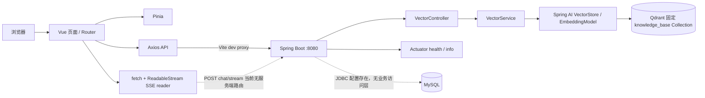
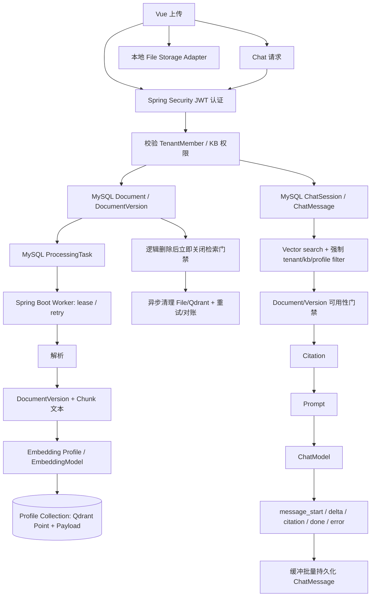

# 系统架构基线与实现状态

本文分开记录 **Accepted 目标架构** 和 **当前代码实现**。Accepted 决策索引见 [`../decisions/README.md`](../decisions/README.md)；一致性冲突/PENDING 详见 [`consistency-analysis.md`](consistency-analysis.md)。架构决策已确认不等于功能已交付。

## 1. 技术栈与模块

前端配置见 `frontend/package.json`：Vue 3.5、TypeScript 5.7、Vite 6、Vue Router 4、Pinia 2、Element Plus 2、Axios 1。后端 `pom.xml`：Java 17、Spring Boot 3.5.7、Spring AI BOM 1.1.0、Maven，Spring AI 官方 Qdrant VectorStore starter。MySQL 目前只有 JDBC 驱动及连接参数；尚无业务 DAO/Repository/实体/schema。

- `frontend/src/views/`：Dashboard、Chat、Knowledge、Document/Chunks、Evaluation、Users、Tenants 页面。
- `frontend/src/api/`：功能 API 与 SSE reader；`registry.ts` 用于页面状态提示，不覆盖所有 API 函数。
- `frontend/src/stores/`：Pinia app/chat/system/tenant 状态；侧栏、会话和 tenantId 有 localStorage 本地状态。
- `spring-ai-qdrant-rag/.../controller/VectorController.java`：当前唯一业务 Controller，提供向量 add/search。
- `.../service/VectorService.java`：使用 Spring AI `VectorStore` 写入 Document 和执行相似度检索。
- `.../dto/`、`.../common/ApiExceptionHandler.java`：请求/响应 DTO、校验和当前异常响应。
- `src/main/resources/application.yml`：模型 provider、Qdrant、MySQL 参数、Actuator 配置。

## 2. 当前实现图

开发代理默认 `http://localhost:8080`（`frontend/vite.config.ts`）。Qdrant Compose 映射 HTTP 6333、gRPC 6334，并持久化到命名卷。生产部署拓扑按 ADR-011 目标规划，尚未实现。

## 3. 当前 API 和页面对接状态

| 页面/模块 | 当前后端能力 | 状态 |
|---|---|---|
| Dashboard/顶栏 | `GET /actuator/health`、`GET /actuator/info` | 当前已配置暴露并由前端调用；`health.show-details: always`，生产访问策略须落实 ADR-010。统计聚合未实现。 |
| Document 手工向量写入 | `POST /api/vector/add` | 单条 Document 文本向量写入；不是文件上传/解析。 |
| Chunks、Chat 引用检索、Evaluation | `POST /api/vector/search` | topK 相似度检索，按请求 tenantId 做 metadata filter；不是文档切片分页接口。 |
| Chat/Knowledge/文档管理/评估/用户/租户管理 | 前端契约或页面 | 后端无对应业务 Controller，未实现。 |

当前 add 请求 `{id,content,tenantId,category}`，字段非空，成功 201 `{id,status}`；search 请求 `{query,tenantId,topK}`，topK 1..100，响应 `[{id,content,score,metadata}]`。`VectorService` 未做认证/资源授权，tenantId 来自客户端。当前错误 Advice 校验失败为 `{timestamp,error}`，其他异常为 `{timestamp,error,message}`；尚未实现 ADR-010 的统一 `{code,message,data,traceId}` envelope、traceId、业务异常、审计及限流。

## 4. 目标安全/授权边界（ADR-001/002/003/010）

Accepted 目标：全局 User、多租户 TenantMember；Spring Security + JWT；TenantMember 角色 OWNER/ADMIN/MEMBER；OWNER/ADMIN 拥有租户内 KB 管理权限，MEMBER 需 KnowledgeBaseMember 明确授权。所有受保护资源通过可信身份和数据库权限服务端校验，客户端 tenantId/userId 不能作为授权依据。系统级管理员边界、KB 角色矩阵和 token 生命周期仍 PENDING。

目标请求链：认证得到 Principal → 校验 TenantMember → 校验 KB 归属和 KnowledgeBaseMember → 产生可信 tenant/kb scope → 调用业务/向量层。Qdrant Payload Filter 必须由服务端使用可信 scope 构造，不替代业务授权。以上尚未在当前代码实现。

## 5. Accepted RAG/文档/向量架构边界

- ADR-004：同一 Embedding Profile 的 Collection 由多个租户/KB 共享；服务端强制 Payload Filter；不同 Profile 向量空间不混用，Collection 按 Profile 管理。
- ADR-005：首版本地文件系统，通过接口预留 MinIO/S3；租户内 SHA-256 去重；Document 逻辑删除并异步物理清理；支持 PDF/DOCX/TXT/Markdown，业务 API 不暴露物理路径。
- ADR-006：MySQL 保存完整 Chunk 文本；Chunk 与 Qdrant Point ID 相同（建议 UUID）；Chunk 归属 DocumentVersion；新版本完成校验后切换。
- ADR-007：新模型使用新 Collection；全量迁移和评估通过后按 KB 整体切换 Profile，旧 Collection 暂留回滚；固定集评估 Recall@K/MRR/命中率/延迟。
- ADR-009：MySQL task table + Spring Boot Worker 定时扫描领取，lease/锁定、幂等、可恢复，不急于引入 Broker。
- ADR-012：文档逻辑删除后立即停止检索，后台异步清理并重试。

### C1/C5 实现协调约束（非新增业务决策）

Chunk 是稳定文本身份。依 ADR-006，Chunk UUID 可在不同 Profile 的独立 Collection 中作为相同 point ID；不同 Profile 不可混入同 Collection。系统必须能记录/推导每个 Chunk 对每个 Profile 的索引状态及清理目标。ChunkVector/ChunkIndex 是否作为独立持久实体仍 **PENDING**，旧数据库草案中的单一 `qdrant_point_id` 不足以作为最终模型。

ADR-007 是按知识库整体切换 Profile，因此检索路由必须解析每个 KB 当前生效 Profile，而非假设全系统只有一个 active profile。具体字段和迁移控制状态仍 PENDING。检索不得在未经校准的情况下混排不同 Profile 的相似度分数。

### C2 状态职责约束（状态枚举 PENDING）

- **Document：** 业务资源生命周期和可访问性（含逻辑删除）；不承担每个处理步骤状态。
- **DocumentVersion：** 特定内容版本及其解析/切片/索引产物是否可用、是否为 active version。
- **ProcessingTask：** 一次执行的阶段、领取/租约、attempt、成功/失败/取消、checkpoint 和错误。

ADR-009 列出的阶段名是处理流水线阶段基线；不应全部塞进同一个 Document.status。具体状态字段、枚举、合法转移、超时/取消规则保持 PENDING。新版本失败时保留旧有效版本继续检索为已确认约束。

### C3 逻辑删除的立即检索门禁

Document 逻辑删除生效后，新的检索响应必须立即排除该 Document 的 Chunk，不得等待 Qdrant 异步物理删除。MySQL 与 Qdrant 没有共同事务；实现必须以权威业务删除/active-version 状态进行服务端检索门禁，并以幂等重试清理 Qdrant。使用 MySQL 后过滤、权威 active 集合或其他等效方法属于实现选择；ADR 已确认的语义不能被异步清理窗口削弱。历史 Citation 展示/删除保留细则 PENDING。

## 6. 目标 RAG 流程（尚未实现的部分标记）

当前只实现 VectorController → VectorService → Spring AI VectorStore/EmbeddingModel → 固定 Qdrant Collection 的 add/search 子链路，以及 Actuator 查询。JWT、授权、文件、任务、解析切片、Profile 迁移、ChatModel 调用、服务端 SSE 和业务持久化均未实现。

## 7. SSE 目标

ADR-008 已确认事件名 `message_start`、`delta`、`citation`、`done`、`error`，消息生成期间缓冲并批量持久化，完成时确保完整落库。当前前端 `src/utils/sse.ts` 只有 POST fetch/readable stream parser，没有服务端接口。事件 payload、event ID、顺序细节、断线续传/重复事件、生成取消和部分答案状态仍 PENDING。

## 8. 关联文档

- Accepted 决策和各 ADR PENDING：[`../decisions/README.md`](../decisions/README.md)。
- ER/逻辑字段草案（非最终数据库结构）：[`../database/README.md`](../database/README.md)。
- 功能状态与待确认需求：[`../requirements/README.md`](../requirements/README.md)。
- 13 项决策冲突分析：[`consistency-analysis.md`](consistency-analysis.md)。
