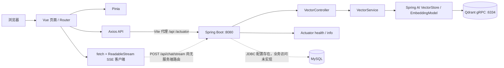
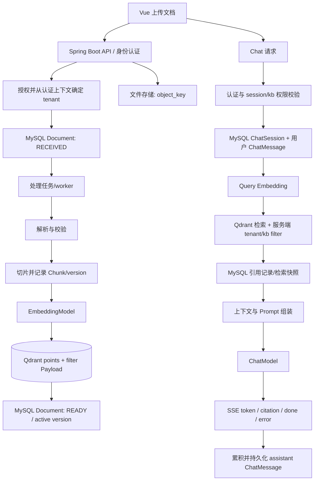

# 当前系统架构与实现边界

状态：基于仓库源码与配置核对；目录名以实际工程为准：`frontend/`、`spring-ai-qdrant-rag/`。

## 技术栈与模块职责

前端依赖见 `frontend/package.json`：Vue 3.5、TypeScript 5.7、Vite 6、Vue Router 4、Pinia 2、Element Plus 2、Axios 1。后端 `pom.xml`：Java 17、Spring Boot 3.5.7、Spring AI BOM 1.1.0、Maven，使用官方 Qdrant VectorStore starter。Qdrant 由 Compose 提供。MySQL 仅有 JDBC runtime 依赖和连接配置，未见业务数据访问层。

- `frontend/src/views/`：Dashboard、Chat、Knowledge、Document/Chunks、Evaluation、Users、Tenants。
- `frontend/src/api/`：按功能封装 HTTP/SSE 请求；`registry.ts` 供接口状态展示，未覆盖所有 API 函数。
- `frontend/src/stores/`：Pinia app/chat/system/tenant 状态；部分值在 localStorage。
- `frontend/src/router/index.ts`、`layouts/DefaultLayout.vue`：hash 路由、导航、页面状态标签、tenantId 输入。
- 后端 `controller/VectorController.java`：目前唯一业务 Controller，提供 add/search。
- `service/VectorService.java`：组装 Spring AI Document、调用 VectorStore，检索时应用 tenantId filter。
- `dto/`、`common/ApiExceptionHandler.java`：请求/响应 DTO、参数校验、错误响应。
- `application.yml`：模型、Qdrant、MySQL 参数与 Actuator 配置。

## 架构图

Vite 开发代理默认目标 `http://localhost:8080`（`frontend/vite.config.ts`）。生产部署拓扑待确认。

## 页面、接口与后端实现状态

| 页面 | 对应后端 | 状态 |
|---|---|---|
| Dashboard、顶栏状态 | `GET /actuator/health`、`GET /actuator/info` | 已暴露并调用；聚合统计 `/api/dashboard/stats` 未实现。health details 当前配置为 always。 |
| Document / 手工向量写入 | `POST /api/vector/add` | 已实现单条文本片段写入；不是文件上传或解析。 |
| Chunks、Chat 引用检索、Evaluation | `POST /api/vector/search` | 已实现 topK 相似度检索和 tenantId metadata filter；不是按文档切片分页。 |
| Chat、Knowledge、文档管理、评估、Users、Tenants | 前端 API 契约 | 后端没有对应业务 Controller，待开发。 |

### 已实现接口

- `POST /api/vector/add`：JSON `{id,content,tenantId,category}`；字段 `@NotBlank`；201 返回 `{id,status:"stored"}`。服务构造 Spring AI Document，metadata 为 tenantId/category，文本为 Document 内容。
- `POST /api/vector/search`：JSON `{query,tenantId,topK}`；query/tenantId 非空，topK 1..100；返回 `[{id,content,score,metadata}]`。服务端构造 tenantId filter expression。
- `GET /actuator/health`：Spring Boot Health 响应；`show-details: always`、`show-groups: true`，具体 components 取决于运行时自动配置。
- `GET /actuator/info`：返回配置的 `info.*` 等信息；不保证存在 build/git 字段。

错误处理：参数校验失败 Advice 返回 400 `{timestamp,error}`；其他 Exception 返回 500 `{timestamp,error,message}`。Spring 默认 404/405 不一定经过该 Advice。前端 `api/http.ts` 将 404/405/415/501 归类为 pending，网络错误另行提示。成功响应无统一外层包装。

## SSE 与 RAG 流程状态

`frontend/src/utils/sse.ts` 用 fetch POST JSON 并读取 ReadableStream，按空行解析 SSE block 和 `event:`/`data:` 字段，支持 AbortSignal、状态码和 Content-Type 检查。Chat 预留 `{conversationId,message,tenantId,topK}`。后端没有 ChatController、SSE producer、ChatModel 调用入口或已确认事件协议。因此只有客户端 reader 已实现，端到端 SSE 未实现；事件名、data schema、结束/错误事件待确认。

| 完整 RAG 步骤 | 当前状态 |
|---|---|
| 文档上传 | 未实现；无 multipart Controller。配置 multipart 限制不构成上传能力。 |
| 文档解析 | 未实现；无解析器代码。 |
| 文本切片 | 未实现；无 splitter/处理流水线。 |
| Embedding | VectorStore 写入/检索时由 Spring AI 调用模型；无文档处理管线。 |
| Qdrant 存储 | 已实现单条 Document 写入固定 `knowledge_base` Collection。 |
| 用户提问 | 前端有 Chat UI；后端 Chat API 不存在。 |
| Query Embedding | `/api/vector/search` 流程中由 VectorStore 使用；Chat 流程无入口。 |
| 向量检索 | 已实现 `similaritySearch` 与 topK。 |
| Metadata Filter | 已实现 tenantId 条件；category 被保存但搜索接口未提供 category 参数。 |
| Prompt 组装 | 未实现。 |
| LLM 生成 | 配置 Chat provider/model；无业务代码调用 ChatModel/ChatClient。 |
| SSE 返回 | 服务端未实现；仅前端解析器已实现。 |

## 安全现状

未发现登录认证、JWT、Spring Security、token 请求拦截器或基于角色的路由守卫。前端 tenantId 可编辑并存于 localStorage，随请求发送；默认 `default` 不是服务端租户记录。Qdrant search 按客户端请求中的 tenantId 过滤，但服务端未将其绑定认证身份；调用方可尝试传其他 tenantId，因此不能视为授权级租户隔离。向量 add 同样信任客户端 tenantId。Actuator health details 当前 always，生产匿名暴露策略待确认。

实体关系草案见 [`../database/README.md`](../database/README.md)，需求状态见 [`../requirements/README.md`](../requirements/README.md)。

## 目标处理与问答流程（建议方案，未实现）

模块责任建议：Spring Boot API 负责身份验证、授权、请求校验和业务状态；关系型 Repository 负责 MySQL 元数据；文件存储适配器负责原件；可重试 worker 负责解析、切片、Embedding 和 Qdrant upsert；RAG service 负责权限过滤、检索、Prompt 与 ChatModel；SSE controller 传递流并处理断开；Chat service 负责最终消息状态和引用持久化。当前代码只覆盖 VectorController→VectorService→Spring AI VectorStore→Qdrant 的向量写入/检索部分，其余框图组件均为建议方案。

## 用户与租户权限建议（待确认）

建议支持一个用户加入多个租户，通过 TenantMembership 保存租户内角色；单租户部署也可用一对多简化，但会限制后续跨租户协作。登录后由身份主体获得用户 ID，再由租户选择/活动租户上下文选择可访问 Tenant；服务端验证 membership 后将 tenantId 放入可信 request context。浏览器传来的 tenantId 只能作为选择提示，不能直接作为授权依据。系统管理员与租户管理员/普通成员分开授权，系统管理员跨租户能力应显式审计。

所有 tenant-scoped API（向量 add/search、知识库、文档、切片、会话/消息、上传和删除）必须从已验证的认证/授权上下文确定租户或校验资源归属；对知识库资源还需校验 KnowledgeBaseMember/租户角色。禁止仅以客户端 query/body 的 tenantId 决定数据权限。认证协议（JWT/OIDC/session）、角色定义及系统管理员策略仍待确认，本建议不构成已批准安全设计。

## Qdrant Collection 选择建议（待确认）

候选方案、成本和适用情境见 [`../database/README.md`](../database/README.md)。当前适合先评审“共享 Collection + 强制 Payload filter”，避免按每个知识库产生大量 Collection；建议按 embedding profile/维度拆 Collection，Payload 同时包含 tenant/kb/document/chunk/version 标识。此选择必须在隔离等级、规模、模型切换与运维能力确认后通过 ADR 批准。即使共享 Collection，Payload filter 也不能替代 MySQL 授权判断；检索过滤必须由后端基于可信上下文生成。
