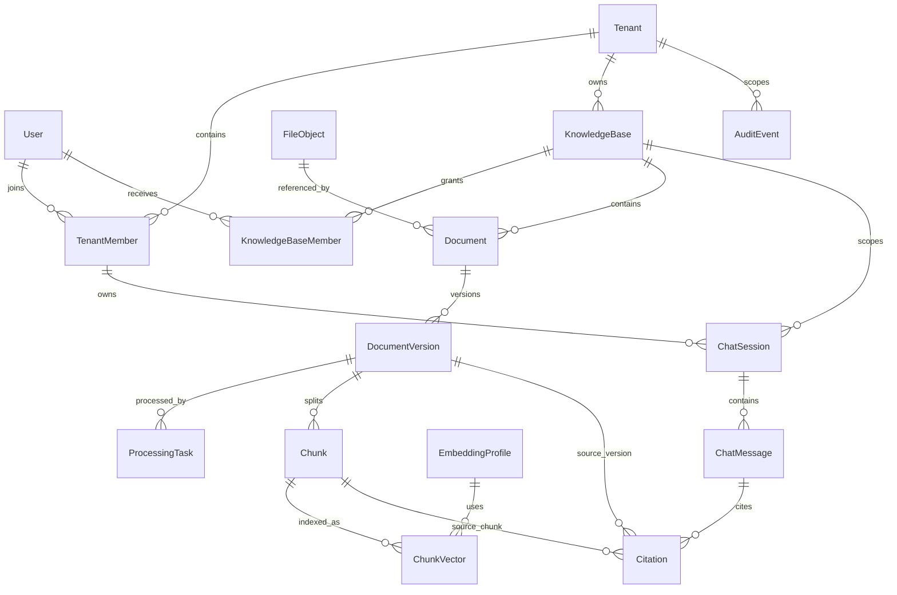

# 13 项架构决策一致性分析

状态：分析报告；不是 ADR，也不批准数据库最终结构。依据为任务中明确给出的 13 项已确认决策及 PENDING 清单，并对照当前仓库代码与配置。报告中的推荐均为分析建议，不能当成正式决策。

## 第二阶段处置状态（2026-11-25）

本报告的 C1-C5 后续处置以 Accepted ADR 为准；本表不把分析建议升级为新增业务决策。

| 冲突 | 第二阶段处置 | 仍待确认 |
|---|---|---|
| C1 Chunk/Point 多 Profile | ADR-006 约束稳定 Chunk UUID 可在不同 Profile 的独立 Collection 作为相同 Point ID；同一 Collection 不混向量空间。 | ChunkVector/ChunkIndex 是否独立持久化及每 Profile 状态字段。 |
| C2 三层状态 | ADR-009 与 ADR-006/012 已明确 Document、DocumentVersion、ProcessingTask 分开承担资源、产物和执行状态。 | 各状态枚举、转移、任务超时/取消。 |
| C3 逻辑删除和异步清理 | ADR-012 已明确删除后立即停止检索；实现必须设置权威业务可用性门禁，不得依赖 Qdrant 删除完成。 | 门禁具体实现、缓存/一致性和物理清理期限。 |
| C4 File 去重与 Document | ADR-005 约束业务 API 不暴露路径，文档逻辑删除后异步清理；FileObject 与 Document 是分析层面的不同职责。 | 物理复用、引用计数、FileObject 是否单独持久化及删除时机。 |
| C5 KB/Profile 切换 | ADR-007 已确认按 KB 整体切换 Profile；实现必须能解析每 KB 当前有效 Profile 并路由到其 Collection。 | 字段/状态模型、迁移增量同步、切换和回滚细节。 |

原分析章节中的方案比较仍是评估依据；若其“推荐需用户确认”文字与本表有差别，以正式 Accepted ADR 与本处置表为准。未决的实现细节继续 PENDING。

## 1. 分析范围和依据

读取了根 `AGENTS.md`、Workspace README、architecture/requirements/database/development/tech-stack/decisions/tasks 文档；`Workspace/decisions/` 当前只有 `README.md`，没有正式 ADR 文件。检查前后端相关的 `VectorController`、DTO、`VectorService`、异常处理器、`application.yml`、`pom.xml`、Qdrant Compose、前端 domain/vector 类型、vector/chat API、SSE reader、tenant/chat stores。

报告以本任务提供的 ADR-001 至 ADR-013 决策内容为评审基准。当前实现事实只从源码/配置判断；历史 Workspace 的规划描述不作为实现证据。

## 2. 当前系统真实实现情况

- 后端唯一业务 Controller 是 `VectorController`：`POST /api/vector/add` 与 `POST /api/vector/search`。Add 接受 id/content/tenantId/category；Search 接受 query/tenantId/topK。
- `VectorService` 使用 Spring AI `VectorStore` 写入 Document，metadata 是 tenantId/category；search 将请求 tenantId 拼为 Qdrant filter。它没有认证身份、授权检查、KnowledgeBase、DocumentVersion 或 Chunk 的业务关联。
- Spring Boot 3.5.7、Spring AI 1.1.0、Java 17；官方 Qdrant VectorStore starter。Qdrant 使用固定 `knowledge_base` Collection，启用 schema 初始化。Ollama/OpenAI profile 在配置中，但实际 chat 模型没有被业务服务调用。
- MySQL 有 JDBC starter/驱动和连接属性，但未发现业务 Entity、Repository、DAO、DDL 或迁移。
- 前端 Vue 页面有待开发能力；Chat history 是 localStorage Conversation，当前消息 role 只有 user/assistant。`fetch + ReadableStream` SSE parser 存在，但后端没有 SSE endpoint。
- 未发现 Spring Security、JWT、登录接口、服务端 tenant membership 或操作审计。前端 tenantId 可编辑并持久化。

因此，13 项是目标架构决策（按用户声明为已确认），当前代码仅实现其极小子集；实现差距不构成决策无效。

## 3. 13 项决策一致性检查

| 决策 | 一致性检查结果 | 当前实现差距/依赖 |
|---|---|---|
| ADR-001 用户与租户 | 全局 User + TenantMember，用户可多租户，租户角色归属 Member，关系唯一性清晰。 | 无业务表；活动租户选择、离开/禁用成员后的会话与任务权限待设计。依赖 ADR-002/003。 |
| ADR-002 认证 | Spring Security + JWT 与后端可信 Principal 可兼容。 | Token 生命周期明确为 PENDING；还需确定禁用用户/成员后已签 token 如何及时失效。未实现。 |
| ADR-003 租户/KB 授权 | OWNER/ADMIN 拥有租户内 KB 管理权限，MEMBER 通过 KB member 授权；资源授权须服务端执行。 | KB 角色矩阵与系统管理员边界 PENDING。OWNER/ADMIN 是否可读/检索 KB、是否能管理成员需落实到权限矩阵。 |
| ADR-004 Qdrant | 每 embedding profile 管理 Collection，同 profile 的 tenant/KB 共用，强制 Payload filter。 | 与多 profile 同时迁移/Chunk ID 冲突有关（ADR-006/007）；共享 Collection 只提供过滤，不是授权边界。无对应 payload 或服务端授权。 |
| ADR-005 文件 | 本地文件系统、Storage abstraction、逻辑删除+异步清理、租户内 SHA-256 去重，格式范围明确。 | 物理文件共享和 refcount PENDING；必须定义 File 对象与 Document 引用的分离，否则去重实体与业务文档混为一体。无文件代码。 |
| ADR-006 Chunk | Chunk 保存完整文本、版本化、建议 UUID、点 ID 相同；按版本维护切片元数据。 | “Chunk ID=Point ID”与同 Chunk 在多个 profile 同时有点存在逻辑冲突；推荐稳定 Chunk 与 Profile-specific 索引映射，但是否正式增加实体须决策。 |
| ADR-007 模型迁移 | 新模型新 Collection、KB 整体 profile 切换、验证后切换、旧库保留和固定集评估。 | 迁移增量同步机制 PENDING；全量扫描与切换之间存在新增/更新/删除丢失窗口，无法只靠最终全量验证解决。 |
| ADR-008 Chat/SSE | Session 绑定 tenant/user/KB；消息支持四种 role；Citation 独立关联；生成期间缓冲批量持久化。 | SSE 事件名已定但序列/重连与消息部分输出状态待细化；citation 对删除版本的展示权限/快照策略待确认。 |
| ADR-009 文档任务 | MySQL task table + Spring Worker polling；租约、恢复、幂等；暂不引入 broker。 | task 与 Document/Version 生命周期需分开；租约过期、任务取消/超时/人工重试均 PENDING。 |
| ADR-010 API/安全 | Envelope、traceId、HTTP 状态、异常体系、分页、审计、鉴权、限流、上传限制和 Actuator 最小暴露。 | 当前裸响应、校验/全局错误体不同、无 traceId/业务异常/安全/限流/审计；属于明确实现差距。分页大小 20/100 目标已明确。 |
| ADR-011 运维 | Compose 单机部署、环境隔离、Actuator/Micrometer、联合备份与恢复演练。 | 当前 Compose 仅包含 Qdrant，MySQL/本地文件/API 未纳入；DEV/TEST/PROD 配置隔离和备份流程未实现。与 ADR-005 文件及 ADR-007 双 Collection 备份需协调。 |
| ADR-012 生命周期/配额 | 按类型保留，文档逻辑删除后立即停止检索，异步清理；Chat 可主动删除，审计独立保留；配额配置化。 | 配额默认值/超限 PENDING；删除后 Qdrant 物理清理延迟时，必须有同步检索门禁；Chat/引用保留 PENDING。 |
| ADR-013 容量 | 100 tenants、1000 users、20 Chat、5 Workers、普通 API P95 500ms，分层并发控制。 | 目标不是实测；未定义“普通 API”是否排除检索/上传、Chat latency/throughput、测试数据规模与统计窗口；供应商配额待定。 |

## 4. 已发现的架构冲突

本报告计 **5 项决策/目标之间需要协调的架构冲突**。这里的“冲突”指存在不补充规则就无法同时无歧义实现的设计点，不代表已确认决策互相否定。

### C1. Chunk ID 与跨 Profile 多向量

- **问题描述：** ADR-006 要求 Chunk ID 与 Qdrant Point ID 相同；ADR-007 要求模型迁移期间新旧 Profile/Collection 并存，同一 Chunk 可能同时有多个向量 Point。若 Point ID 固定等于 Chunk ID，两个 Collection 可使用相同 ID，但 MySQL 无法用一个 `qdrant_point_id` 字段表达多份索引及各自状态；若同一 Collection 混放不同 profile，则违反向量空间隔离。
- **涉及的 ADR：** ADR-004、006、007。
- **冲突或风险：** 将唯一 point ID 放 Chunk 上会丢失 Profile 维度；无关联实体时难以记录每 profile 的索引状态、重试及清理。
- **可选方案：** A. 引入 ChunkVector/ChunkIndex，每 `(chunk_id, profile_id)` 一条；point ID 可为 Chunk UUID（不同 Collection 中复用）或独立 UUID。B. 不建关联实体，把所有向量状态塞入 Chunk JSON/字段。C. 迁移期间不并存，仅停机原地重建。
- **推荐方案：** 评估并优先采用 A；稳定 Chunk 文本/ID 与按 profile 的索引副本分离。建议唯一键 `(chunk_id, embedding_profile_id)`、索引状态和 point_id/collection 逻辑映射，但字段与约束不在本报告定案。
- **推荐理由：** 可表达多 profile 并行、部分失败、重试和旧索引清理；避免把可变索引状态绑定到稳定内容实体。Chunk UUID 作为 point ID 只在一个 Collection 对应单一 profile 的前提下安全。
- **是否需要用户确认：** 是；是否批准独立逻辑实体/映射及 point ID 规则需确认，PENDING。
- **对后续开发的影响：** 数据库逻辑模型、Qdrant upsert/delete、迁移任务均依赖此决定。

### C2. 文档状态、版本状态与任务状态混用

- **问题描述：** ADR-009 列出的 UPLOADED、QUEUED、PARSING、CHUNKING、EMBEDDING、INDEXING、COMPLETED、FAILED、CANCELLED 是处理过程状态；ADR-006/007 又有 DocumentVersion 与 active version；ADR-012 定义 Document 逻辑删除。若这些都塞入 Document.status，就不能同时表达“当前版本 READY、下一版 PARSING、文档仍可检索”。
- **涉及的 ADR：** ADR-005、006、007、009、012。
- **冲突或风险：** 新版本处理中错误地将旧有效版本下线；Task 取消被误认为文档删除；FAILED 丢失旧版是否仍服务的信息。
- **可选方案：** A. Document 记录逻辑资源/删除状态与 active_version；DocumentVersion 记录内容版本/索引就绪状态；ProcessingTask 独立记录执行状态。B. 单一 Document 状态并附加多个布尔字段。C. 把所有版本状态直接作为任务状态推导。
- **推荐方案：** A，且分别定义状态职责后再定枚举；任务状态驱动处理尝试，版本状态描述产物可用性，Document 状态描述业务资源可访问性。
- **推荐理由：** 与“新版本失败保留旧版”的 ADR-007/009 要求兼容，允许资源、产物和执行过程独立演进。
- **是否需要用户确认：** 枚举、终态和转移规则待确认；三层职责分离是建议，PENDING。
- **对后续开发的影响：** 上传/重处理 API、Worker 恢复、检索可用版本选择和删除门禁依赖状态机。

### C3. 逻辑删除立即停止检索与异步物理清理

- **问题描述：** ADR-012 要求删除立即停止检索，但 MySQL 与 Qdrant 无共同事务，Qdrant point 异步删除可能延迟或失败。只把 Document 标记 DELETED 而继续直接查 Qdrant，会在清理完成前返回其 Chunk。
- **涉及的 ADR：** ADR-004、005、006、009、012。
- **冲突或风险：** 删除语义和访问控制出现时间窗；历史引用也可能被错误当作继续检索/下载权限。
- **可选方案：** A. 检索过滤只基于 Qdrant payload；B. 检索后按 MySQL active document/version 集合二次校验；C. 先同步物理删除 point，再标记删除；D. Payload 增加可用标记并双写维护。
- **推荐方案：** 建议服务端检索始终强制租户/KB filter，并在删除标记事务后对候选结果依据 MySQL 权威 Document/Version 状态二次校验；同时异步幂等清理 Qdrant。可评估只查询 active version 的 payload filter 作为优化，但不作唯一删除门禁。
- **推荐理由：** 不依赖 Qdrant 清理时延或跨库原子事务，即可做到逻辑删除后拒绝新检索结果；代价是读路径增加校验与缓存一致性问题需评估。
- **是否需要用户确认：** 需要确认“删除立即停止检索”的权威判定及接受的查询时延/一致性策略；物理删除期限仍 PENDING。
- **对后续开发的影响：** 搜索 service、删除任务、引用展示/下载授权和一致性对账都依赖此策略。

### C4. SHA-256 去重与逻辑文档删除/文件清理

- **问题描述：** ADR-005 同时要求租户内内容去重、逻辑删除与异步物理清理，但明确文件复用和引用计数待确认。若一个物理对象被多个 Document 引用，删除一个 Document 不能物理删除文件；若没有稳定 File 实体，无法可靠判断是否仍有引用。
- **涉及的 ADR：** ADR-005、012。
- **冲突或风险：** 过早删文件导致其他文档损坏；引用计数漂移导致泄漏；跨租户去重可能泄露文件存在性（租户内去重决策不等于跨租户去重）。
- **可选方案：** A. File 作为内容对象，Document 引用 File；维护事务型引用数/派生引用数。B. 去重只做检测提示，不复用物理对象。C. 每个 Document 独立存文件，上传时仍计算 hash 供完整性检查。
- **推荐方案：** 建议使用独立 File/StoredObject 概念承载 hash、路径和物理清理状态，Document 表示业务归属/版本；具体复用、计数算法和删除时机保持 PENDING。
- **推荐理由：** 概念上区分物理字节与业务文档，支持未来复用，同时不强迫现在拍板引用计数机制。
- **是否需要用户确认：** 是；题目明确列为 PENDING。
- **对后续开发的影响：** 文件适配器、删除流程、配额统计和数据库关系设计受影响。

### C5. 共享 Collection 与 Profile 生命周期/迁移切换

- **问题描述：** ADR-004 定义一个 Profile 对应向量空间及 Collection，多个 tenant/KB 共用；ADR-007 要求每知识库整体切换 Profile，迁移期新旧 Collection 并存。若 Profile 是全局配置，一个 collection 同时含多个 KB，但不同 KB 可在不同时间切换至不同 profile，需要检索按 KB 的当前 profile 路由，不能只用单个全局 active collection。
- **涉及的 ADR：** ADR-003、004、007、009、012。
- **冲突或风险：** 全局 profile active pointer 会使尚未迁移 KB 无向量可查；同时检索新旧 collection 容易重复返回或混排不兼容 score；KB 与 profile 变更竞态。
- **可选方案：** A. KnowledgeBase 记录 active_embedding_profile_id，查询时按 KB profile 路由；B. 整个系统一次性全局切换所有 KB；C. 迁移时双读双写并按 chunk 去重/重排。
- **推荐方案：** 依据 ADR-007“按知识库整体切换”建议 A；迁移期每 KB 明确 source/target profile 与阶段，检索只读该 KB 当前生效 profile，切换操作在 MySQL 原子更新 KB 指针后生效。
- **推荐理由：** 与 per-KB 原子切换语义一致，不需将不同模型分数直接混排。MySQL 指针切换不意味着向量写入本身跨库原子，任务/增量同步仍需补充。
- **是否需要用户确认：** 需要确认 Profile 对 KB 的归属/切换粒度及迁移期读写规则；增量同步 PENDING。
- **对后续开发的影响：** KB 数据模型、检索路由、版本任务和模型迁移控制面依赖此决定。

## 5. 潜在设计风险

本报告计 **12 项潜在风险**（其中多项是实现差距或尚缺运行约束，不都属于决策冲突）：

1. 当前 add/search 信任客户端 tenantId，缺少认证/授权，和 ADR-002/003/010 目标不一致；不能在当前实现上承载真实租户数据。
2. 当前固定单 Collection 且无 embedding profile 记录/KB ID；不满足 ADR-004/007 的目标隔离和迁移管理。
3. 当前 Qdrant point ID 由请求原始字符串给出，未验证 UUID 格式；与 ADR-006 的 UUID 建议不一致。
4. 无 Document/Version/Chunk/Task 关系，当前手工向量无法追溯来源、版本或可靠删除。
5. MySQL 与 Qdrant 无共享事务；若任务/Outbox/对账没有可靠持久化，worker 崩溃会遗留孤儿 point 或状态卡住。
6. 每个 Point Payload 的 tenant/KB 字段尚未建立；即使过滤表达式存在，当前过滤字段 tenantId 仍来源于不可信请求。
7. Active version 与 Qdrant 清理异步之间需要读路径可用性门禁；否则无法兑现“立即停止检索”。
8. 文档任务租约必须考虑锁过期、worker 心跳、重复领取、时钟/进程崩溃与同一版本写入幂等；只描述“有锁”不足以保证 exactly-once（应按 at-least-once + 幂等设计）。
9. Worker 数 5 不等于 Embedding 并发 5；批量 embedding、供应商限速、Chat 优先级和租户公平性未定义，可能造成 Chat 资源饥饿。
10. Chat 缓冲批量持久化时，断线/进程崩溃可能只有部分 delta 未落库；需区分生成状态、已发出内容、已持久化内容和重连 replay cursor。
11. Citation 指向 DocumentVersion/Chunk 后，源文件逻辑删除或 chunk 清理后须保留可展示快照，同时重新鉴权阻止原件下载；快照字段和保留期未确认。
12. ADR-013 的 500ms 普通 API P95 没有排除检索、LLM、文件 I/O，也无负载模型/测量窗口；若目标口径不清，会无法验收。

## 6. 推荐补充设计

### 6.1 身份与权限上下文

**分析结论（不代替具体角色决策）：** Spring Security 负责认证过滤链并解析 JWT；JWT subject 标识全局 User。每个 tenant-scoped 请求从可信 principal 取 userId，再用当前 tenant 选择器校验 TenantMember active 状态并解析租户角色。客户端 tenantId/userId 仅作为资源选择输入，不能当授权依据。访问 KB 时再校验其 tenant_id 和 KnowledgeBaseMember；ADR-003 已明确 OWNER/ADMIN 对本租户 KB 管理权限、MEMBER 需显式 KB 授权。系统级管理员角色/权限边界 PENDING，不在此设计。

**模块边界建议：** AuthN filter/provider 建 principal；TenantContext resolver 校验成员关系；Authorization service 执行 tenant/KB 资源授权；Controller 不自己拼决定权限的过滤条件；Vector/RAG service 接收已授权的 KB scope 并构造不可由客户端覆盖的 Qdrant filter。

### 6.2 File 与 Document 生命周期

建议概念分离：`File/StoredObject` 表示本地物理对象、hash 和清理状态；`Document` 表示知识库内用户可管理资源；`DocumentVersion` 表示不可变的内容/解析版本。文档逻辑删除先让 Document 对新检索不可用，再异步清理版本向量和文件引用。文件何时可物理删除、hash 命中是否复用同一对象及引用计数算法均保持 PENDING。文件系统不能参与 MySQL 事务，应记录清理意图/状态，执行可重试幂等物理删除并定期对账；恢复策略需避免已删除对象被业务重新暴露。

### 6.3 Chunk 与索引

推荐逻辑实体草案：DocumentVersion 1:N Chunk；Chunk 持久化完整文本、chunk_index、token_count、字符范围、content_hash；ChunkVector/ChunkIndex 表示 Chunk 在某 Embedding Profile/Collection 的 point 映射与 index status。该表是逻辑设计候选，不代表批准建表。共享 Collection 下可复用 Chunk UUID 作为每个 profile Collection 内 point ID，但 profile 不同必须不同 Collection；若将来一个 profile 可有多个物理索引/代际，则映射应使用独立 Qdrant point UUID，不能假设 point ID 全局等于 Chunk ID。

### 6.4 MySQL–Qdrant 最终一致性

跨库事务不可用时，不能把“同一个方法先写 MySQL 再写 Qdrant”视为原子。分析建议采用持久化处理任务/变更意图 + 幂等 upsert/delete + 状态回写 + 周期性对账：

1. MySQL 事务创建 DocumentVersion/Chunk/索引任务，任务有稳定幂等键。
2. Worker 取得带 lease 的任务，执行外部 embedding 与 Qdrant upsert；重复执行覆盖同一目标 point。
3. 写入完成后回写 index state/任务 checkpoint；若回写失败，重放仍安全。
4. 删除先提交业务不可用状态，再异步删 point/file；任务记录重试，结果通过 Qdrant/MySQL 清单对账。
5. Profile 迁移期间新增/更新/删除必须有可重放变更来源（持久任务/变更日志/双写机制之一）；全量扫描需有 watermark，切换前追平 watermark 并验证计数和质量。具体增量机制、watermark 与原子切换细节 PENDING。

这是一种分析框架，不是 ADR-007/009 的正式迁移机制，也不承诺跨系统强一致。

### 6.5 状态职责建议（枚举待定）

- **Document 状态：** 用户可见资源生命周期，例如可用/删除中/已删除；不表达解析中。
- **DocumentVersion 状态：** 一次不可变内容版本是否解析完成、是否具备可检索产物、是否 active/failed；旧 active version 可在新版本处理期间继续可用。
- **ProcessingTask 状态：** 一次执行的排队、领取、运行、重试、成功/失败/取消；另存 lease owner/expiry、attempt、checkpoint、error 和幂等键。
- ADR-009 当前列出的处理阶段适合映射为任务阶段或任务事件；UPLOADED 是 Document/Version 接收状态，COMPLETED/FAILED/CANCELLED 是 task 终态概念，不建议不加区分地全部塞进单一 Document.status。最终字段和枚举 PENDING。

worker 使用租约+心跳和过期回收，允许 at-least-once；写 Qdrant 和状态转换须幂等。超时定义、取消边界（哪些阶段可取消）、人工重试是否新 task/新 version、失败补偿策略 PENDING。

### 6.6 Chat、SSE 与引用

Session 的 tenant/user/KB 绑定来自服务端授权上下文并在每次读取历史时重验权限。Message 有 role（ADR-008 已列 USER/ASSISTANT/SYSTEM/TOOL）及生成状态；ASSISTANT 先落一个生成中记录，SSE 发送 message_start、delta、citation、done/error。该事件序列建议理解为 message_start 首发、delta 可重复多次、citation 可一条或多条、最终 done 或 error 二选一；此顺序解释需在 API 契约中确认。每个事件建议带稳定 messageId 与 sequence/eventId，才能支持去重/重放；实际断线恢复和 cursor 方案仍 PENDING。

Citation 独立关联消息、DocumentVersion、Chunk，并记录 score/rank。文档删除后可以保留有限引用展示所需快照，但快照不得成为重新获得已删除原文/文件访问权的凭据。Chat 删除、引用快照、审计保留的软删除与周期均 PENDING。

## 7. 方案对比

### 7.1 Chunk 的多 Profile 索引

| 方案 | 优点 | 缺点 | 适用性 |
|---|---|---|---|
| A. 独立 ChunkVector/ChunkIndex 逻辑实体 | 一 chunk 多 profile/代际；索引状态、重试、point ID 和删除可追踪；Chunk 文本稳定。 | 增加关联记录和查询/事务逻辑。 | 符合 ADR-007 并行迁移；推荐评估。 |
| B. 索引状态嵌入 Chunk 多列/JSON | 初期表少。 | 多 profile 数组难约束、查询和并发更新复杂，无法自然唯一约束。 | 不建议作为需迁移的系统长期模型。 |
| C. Chunk 与 point 永远一对一、停机原地重建 | 模型最简单。 | 与新旧 Collection 并存、回滚和在线服务目标冲突；迁移窗口不可用。 | 仅适合允许停机且不需要回滚的系统；与当前决策方向不合。 |

### 7.2 立即删除与 Qdrant 异步清理

| 方案 | 优点 | 缺点 | 结论 |
|---|---|---|---|
| 只依赖 Qdrant delete | 查询链路简单。 | 删除失败/延迟时仍检索出已删文档。 | 不满足 ADR-012“立即停止检索”。 |
| 服务端以 MySQL 状态二次验证候选 | 逻辑删除后可立即过滤；Qdrant 物理清理可重试。 | 增加 MySQL 查询/批量校验及延迟；缓存需失效。 | 推荐作为语义门禁。 |
| 删除接口同步等待全部 point 删除 | 返回成功时物理结果明确。 | 大文档耗时长、Qdrant 故障阻塞删除；无法保证跨库原子。 | 不宜作为唯一删除流程。 |

### 7.3 迁移期间增量数据来源（尚未决策）

持久任务/Outbox 可重放且与业务事务关联但需要可靠任务消费；变更日志可建立 watermark 但需定义合并/压缩和删除 tombstone；双写新旧 Collection 读写简单可见但会增加模型成本并处理部分失败。建议下一阶段比较后选择，当前统一标记 PENDING。

## 8. 并发与资源隔离分析

ADR-013 的 20 路 Chat、5 个 Worker 是不同维度：Worker 是处理任务数，不等于 embedding 请求数（每任务可并行批量调用）；Chat 是用户请求数，也不等于 LLM provider 并发（一次对话可能串行多次模型调用）。API 并发还包括健康、元数据 CRUD、检索和上传，P95 500ms 应明确排除长耗时流式 Chat/文件处理。

建议分别控制 API 请求队列、每租户请求/Chat 并发、Worker lease/执行并发、Embedding semaphore/速率、LLM semaphore/速率。Worker 与 Chat 共用同一供应商额度时设置独立池/保留 Chat 配额或优先级，避免批量 embedding 抢占所有额度；用全局限速器遵循供应商 RPM/TPM，租户公平调度避免单租户占满。若供应商只有一个总额度，硬分池与动态借用策略影响吞吐，需结合供应商选型与配额评测，不预设数值。

**需确认/验证：** 限流算法、各层上限和排队超时 PENDING；20/5/500ms 是规划目标，需压测定义数据规模、请求混合、模型、统计窗口、错误率和流式首 token/完成延迟。

## 9. 建议的数据库逻辑实体关系（非最终结构）

该 ER 图用于表达职责/关系候选，不含字段类型、基数约束或 DDL。系统级管理员关系不画入，因其身份与权限边界 PENDING。FileObject 物理复用关联及引用数策略 PENDING；ChunkVector 是否以独立表实现也须确认。

## 10. 建议模块边界和数据流

1. **Auth/Security：** 用户凭证校验、JWT 验签和 principal；token 生命周期 PENDING。
2. **Tenant/Authorization：** TenantMember/KB 权限校验，产生可信 tenant/kb scope；拒绝客户端越权。
3. **Knowledge/Document API：** 元数据、版本和逻辑删除状态事务。
4. **File Storage port + local adapter：** 使用受控 object key 存取本地文件，不暴露物理路径；将来可替换 MinIO/S3 adapter（扩展不等于首版引入）。
5. **Processing task/Worker：** MySQL 任务领取、lease、恢复；解析、切分、Embedding 调用和 Qdrant upsert；调度器并发与模型并发分开。
6. **Vector Index adapter：** 依据 KB active profile 选择 Collection，统一写删查和强制 filter；Spring AI VectorStore 可作为抽象实现基础，但 profile 动态路由能力需技术验证。
7. **RAG/Chat：** 权限校验后查询有效版本、构造 Prompt、调 LLM、保存 citation/message 并输出 SSE。
8. **Lifecycle/Audit/Quota：** 异步删除、对账、审计和资源限制；配额阈值 PENDING。

## 11. 待确认事项

以下均明确保持 **PENDING**，不得在 ADR 中擅自填值：

1. Access Token/Refresh Token 生命周期、刷新与撤销。
2. `KB_ADMIN`、`EDITOR`、`VIEWER` 权限矩阵。
3. 系统级管理员身份及权限边界。
4. SHA-256 去重后的物理文件复用和引用计数。
5. 文档任务超时、取消、人工重试和补偿。
6. SSE 断线恢复、续传、重复事件处理。
7. Chat 消息/引用删除、软删除及保留策略。
8. 租户配额默认值和超限处理。
9. Embedding/LLM 供应商选型。
10. Embedding 迁移增量同步和一致性切换。
11. ChunkVector/ChunkIndex 是否成为独立持久实体及 point ID 最终规则。
12. Document、DocumentVersion、ProcessingTask 的具体状态字段/转移矩阵。
13. Document 删除后引用展示快照字段、原文访问授权和保留周期。
14. 限流/并发上限、租户公平性、Chat 与 Worker 模型资源配额。
15. ADR-013 性能指标测试口径（请求范围、数据量、供应商、统计窗口）。
16. MySQL 目标版本/迁移工具、任务表清理和对账频率、备份保留周期。

## 12. 后续 ADR 落地与开发阶段

建议先建立 13 份 ADR 的统一模板并引用本报告，不把本报告的推荐自动升格为 Accepted。ADR 内容只记录已确认条款；对应开放项明确标注 PENDING；决策原因/备选方案若未由评审提供，应作为分析补充而非声称是用户确认理由。

依赖顺序建议：

1. **安全边界确认：** 系统管理员、KB role matrix、Token 生命周期、可信租户上下文。
2. **逻辑模型确认：** File/Document/Version/Task/Chunk/ChunkVector/Citation，删除和保留语义。
3. **向量迁移与 profile 控制面确认：** 增量变更来源、KB profile 切换、回滚和验证门槛。
4. **状态机、API 与 SSE 契约：** 任务/版本状态、Envelope/traceId、事件协议及断线语义。
5. **开发基础：** Spring Security、权限服务、MySQL migration baseline、审计/限流骨架。
6. **文档闭环：** 文件存储和任务 Worker → parsing/chunking/indexing → KB/Document API。
7. **Chat/RAG：** 检索门禁、Prompt、LLM、Citation、消息落库和 SSE。
8. **生命周期/运维：** 配额、删除清理/对账、环境分层、联合备份和恢复演练。
9. **验证上线：** 安全/租户隔离测试、模型迁移测试、负载压测、指标复核。

依赖理由：数据库基准前需确定实体/生命周期；文档与 Chat 之前要有鉴权上下文和资源授权；迁移前要有索引映射与可靠变更来源；性能目标须在真实工作流实现后压测验证。

## 13. 统计结论

- 已识别 **5 项架构决策/目标冲突**：Chunk/Point 多 profile 映射、三层状态混用、逻辑删除即时屏蔽、去重文件复用生命周期、共享 Collection 下按 KB profile 切换。
- 已识别 **12 项潜在风险**，详见第 5 节。
- 可由架构分析直接给出不涉及业务取舍的指导：Document/Version/Task 状态职责应分开讨论；MySQL/Qdrant 不共享事务，操作应幂等并可重试/对账；共享 Collection filter 不替代授权；Worker 数不能代表模型并发。
- 必须由用户/产品/安全评审确认：第 11 节全部 PENDING，尤其系统管理员权限、KB role matrix、文件复用、删除/引用保留、迁移增量同步和并发配额。

## 14. 一致性与实现差距摘要

现有文档中“Chunk 点 ID 相同”与“多 Profile 并行迁移”需要本报告 C1 协调；旧 database 文档中单字段 `embedding_profile_id/qdrant_point_id` 的 Chunk 草案不足以表达多索引，须在最终模型前修订，不能直接拿来建表。旧架构文档把 MySQL/File/Worker/Chat 图标为目标建议，尚不代表代码实现。当前 Qdrant 搜索只依据客户端 tenantId，距离 ADR-003/010 的可信身份授权目标明显不一致；固定 Collection、无业务版本/任务表、无后端 SSE 与 ADR-004 至 009 的规划有差距，但不构成决策失效。

本报告未修改旧结论或代码；后续正式 ADR 阶段应将本报告作为冲突清单与 PENDING 登记来源。
