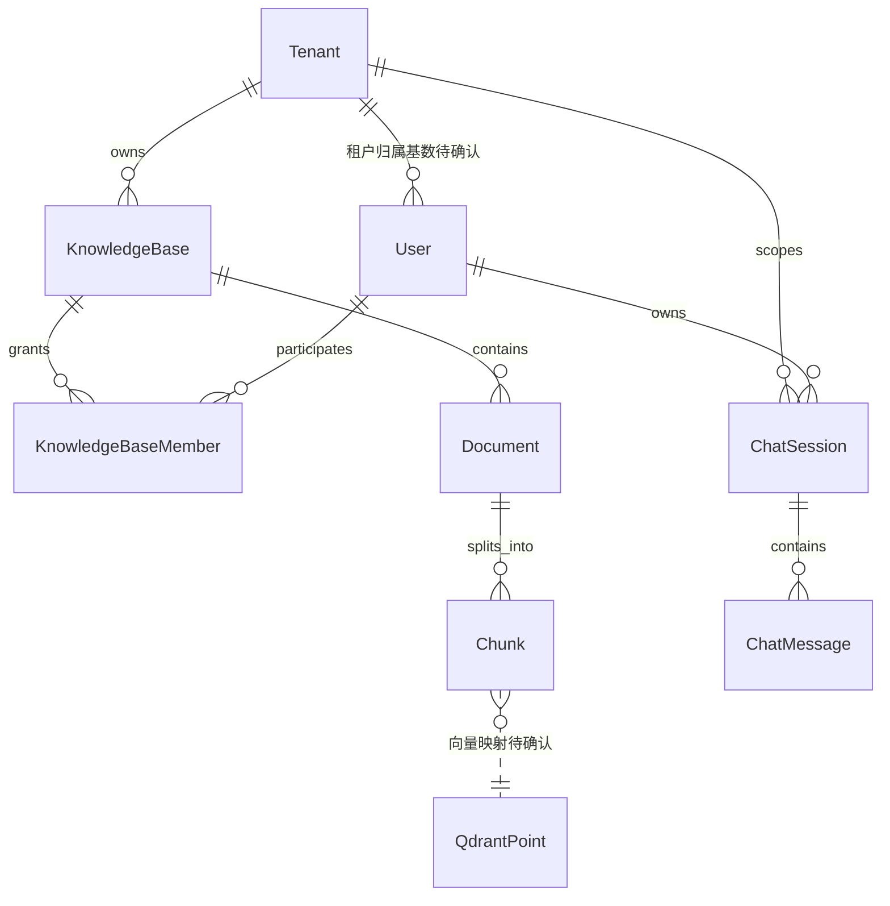

# 数据存储现状与待确认业务模型

以下关系仅为讨论草案，不是批准的 ER 模型，也不代表数据库已有这些表。当前未发现初始化 SQL、迁移脚本/工具、JPA Entity、Repository 或 MyBatis Mapper。

## 当前存储

### MySQL

后端 `pom.xml` 引入 `spring-boot-starter-jdbc` 和 MySQL Connector/J（runtime），`application.yml` 配有 `MYSQL_URL`、`MYSQL_USER`、`MYSQL_PASSWORD` 默认值。源码未发现业务 JDBC 调用或 schema。配置不能证明数据库已启动、已连接或已有业务表；运行状态待确认。

### Qdrant

`docker-compose.yml` 配置 Qdrant，映射 HTTP 6333、gRPC 6334，使用 `qdrant_data` volume。Spring AI VectorStore 默认使用 gRPC 6334、Collection `knowledge_base`，`initialize-schema: true`。`VectorService.add` 写入 Document id/text 及 tenantId/category metadata；search 做向量相似度查询并按 tenantId 过滤。

当前未发现 knowledgeBaseId、documentId、chunkIndex 等已确认 Payload 字段；手工 add 也没有对应文档/切片业务记录。

## 初步实体关系（全部待确认）

| 实体 | 初步职责/关系 | 当前证据状态 |
|---|---|---|
| Tenant | 多租户边界；可能关联 User、KnowledgeBase、Session。 | 后端仅用 tenantId 元数据，无租户实体或 CRUD。 |
| User | 用户身份；经租户归属关系关联 Tenant。 | 无用户实体、认证、表或 API。单租户/多租户归属待定。 |
| KnowledgeBase | 租户内逻辑知识库，拥有文档与成员。 | 无实体/API；Qdrant Collection 固定一个。 |
| KnowledgeBaseMember | User 对 KnowledgeBase 的成员/授权关系。 | 完全待确认，无授权模型。 |
| Document | 原件元信息、状态、存储地址。 | 无上传 Controller、实体或文件存储实现。 |
| Chunk | Document 切片文本、顺序及 Qdrant point 映射。 | 无切片器、实体或按文档查询接口。 |
| ChatSession | 用户/租户会话及标题、状态。 | 只有前端 localStorage Conversation 类型；服务端无持久化。 |
| ChatMessage | Session 消息、角色、内容、引用。 | 前端有本地类型；服务端无实现。 |
| Qdrant Point | Vector 与 Payload，用于相似度检索。 | Spring AI VectorStore 管理；当前已确认 tenantId/category 和 Document 内容/id。 |

## 设计待确认

1. Tenant/User 是一对多或多对多，用户是否可跨租户及管理员权限。
2. KnowledgeBase 是 MySQL 业务实体、独立 Qdrant Collection，还是 MySQL 元数据加单 Collection Payload 隔离。
3. KnowledgeBaseMember 的角色、授权粒度与审计要求。
4. Document 原件存储位置、checksum、版本、异步任务、重试、删除与保留期限。
5. Chunk 与 Qdrant Point 的 ID 映射；Payload 是否需要 tenantId、knowledgeBaseId、documentId、chunkIndex；删除和一致性补偿职责。
6. ChatSession/ChatMessage 持久化、消息顺序、流中断、引用快照、保留与隐私清理。
7. MySQL 版本、迁移工具、主键/审计字段、索引、加密、备份恢复。

确认模型前不创建业务表或初始化 SQL。后续结构变更按根 `AGENTS.md` 同步基准和增量迁移；执行迁移仍需明确授权。

## 建议字段草案（未批准，不是 DDL）

以下仅用于需求评审，字段类型、长度、约束、索引和命名需在确认后再定。

| 实体 | 建议字段方向 |
|---|---|
| Tenant | id、name、status、created_at、updated_at |
| User | id、login_name/email、password_hash 或外部身份 subject、display_name、status、created_at、updated_at；禁止存明文密码/token |
| TenantMembership（若用户可多租户） | tenant_id、user_id、tenant_role、status、joined_at；唯一约束候选 (tenant_id,user_id) |
| KnowledgeBase | id、tenant_id、name、description、status、embedding_profile_id、created_by、timestamps |
| KnowledgeBaseMember | knowledge_base_id、user_id、role、status、created_by、timestamps |
| Document | id、knowledge_base_id、original_name、media_type、size_bytes、checksum、object_key、status、active_processing_version、error_code/message、retry_count、created_by、timestamps |
| Chunk | id、document_id、processing_version、chunk_index、content（或外置存储引用）、token_count、qdrant_point_id、embedding_profile_id、status、created_at |
| ChatSession | id、tenant_id、user_id、title、status、created_at、updated_at |
| ChatMessage | id、session_id、sequence_no、role、content、status、error_code、created_at、completed_at |
| MessageCitation（建议独立引用记录或 message JSON，二选一待定） | message_id、chunk_id、document_id、qdrant_point_id、rank、score、snippet/title snapshot、created_at |

不建议将密码、embedding 向量本体、上传文件二进制或可变检索结果作为普通业务字段随意存储。密码哈希方案、文件存储方案和引用快照形式需另行决策。

## Collection 策略比较

| 策略 | 优点 | 缺点/风险 | 适用情境 |
|---|---|---|---|
| 每租户一个 Collection | 租户间物理集合边界较清晰；可按租户独立清理/迁移。 | 租户多时 Collection 数增长；模型维度/索引配置和运维成本增加；知识库级过滤仍需实现。 | 少量大租户、强隔离或每租户配置差异明显。 |
| 每知识库一个 Collection | 生命周期、embedding 配置及清理边界直观。 | 知识库数量通常多于租户；Collection 爆炸；跨库检索复杂；需动态管理集合。 | 知识库数量有限且需要不同向量配置/独立运维时。 |
| 共用 Collection，Payload Filter | Collection 数少、查询简单，适合当前单 Collection 起步；按 tenantId/knowledgeBaseId/documentId 过滤。 | 隔离依赖每条读写都正确过滤及后端授权；过滤字段索引与规模要管理；不能作为认证替代。 | 多数 SaaS 多租户共享模型/维度且需简化运维。 |

**建议评审方向：** 初期采用一个或少数按 embedding profile 划分的 Collection，并在每个 point 的 Payload 写入 tenant_id、knowledge_base_id、document_id、chunk_id、processing_version；所有访问由服务端从授权上下文构造强制过滤。此为建议，不是已决策。后续确有物理隔离/独立模型需求再拆 Collection。当前 Spring AI 配置固定一个 `knowledge_base` collection，尚未实现上述业务 Payload 字段或授权机制。

## MySQL 与 Qdrant 职责边界建议

| 数据 | 建议主存 | 说明 |
|---|---|---|
| Tenant、User、租户成员/角色 | MySQL | 强一致业务元数据、唯一性和关系约束。 |
| KnowledgeBase、成员授权 | MySQL | 名称、状态、所有者、embedding profile 等管理信息。 |
| Document 元信息、处理状态、重试与版本 | MySQL | 可查询/审计的工作流事实；原文件放对象/文件存储，object_key 入库。 |
| Chunk 元信息、切片文本、顺序、Point ID | MySQL（建议保留规范事实） | 保留文本便于重建向量、按文档展示和追溯；大规模/高敏场景可评估外置文本存储，但不可只剩不可追溯向量。 |
| ChatSession、ChatMessage、引用 | MySQL | 会话历史和可审计业务状态；引用关联 Chunk 并保存检索时 rank/score 及可选快照。 |
| 向量、用于检索的 Payload | Qdrant | embedding 向量与检索需要的 ID/过滤元数据；不把它作为业务关系/事务数据库。 |

MySQL ID 与 Qdrant point ID 建议稳定映射（可让 point ID 使用 chunk UUID，也可保存独立 qdrant_point_id）；必须在确认后统一。Qdrant Payload 至少复制筛选所需标识，但这些副本不是授权事实来源。

## 一致性与模型升级建议

- 文档处理以 MySQL processing version/status 为控制事实。新版本先生成新版本切片与 point，校验数量/可检索性后再原子切换 active version；旧 point 在切换后异步清理。失败时保留旧可用版本并记录错误，避免先删后建造成空窗。
- 删除知识库/文档先在 MySQL 标记 DELETING 并拒绝新查询/写入，发出可重试清理任务删除对应 Qdrant points（按明确的 tenant/kb/document/version filter 或 ID 列表），确认完成后再软删除/终态化。数据库与 Qdrant 无跨库事务，应采用幂等重试与可观测清理状态；物理删除和保留策略待确认。
- embedding 模型、版本或维度变化时不混写同一向量空间。记录 embedding profile（provider/model/revision/dimension/距离度量）；优先建新 collection/profile 做并行重建，校验后切换，再清理旧集合。只有确认允许停机重建时才考虑原地删除重建。
