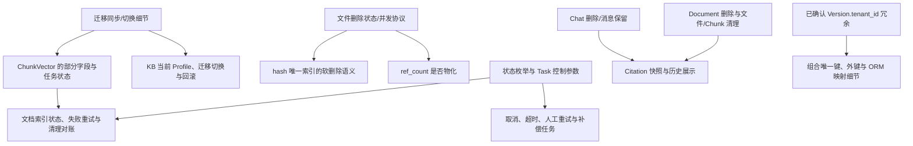

# 数据库逻辑模型确认准备（第二步）

状态：**逻辑模型确认结果归档稿。第 2 节六项结果已由用户确认；具体字段及物理实现仍需字段评审，不是最终 DDL。**

## 1. 范围与当前逻辑模型基线

本稿依据当前 `logical-model.md`、ADR 索引和架构文档，整理尚未关闭的数据库设计问题及其依赖。ADR-001 至 ADR-013 的 Accepted 决策不在本轮重新评审。当前 MySQL 尚无业务表、Repository、DDL 或迁移脚本；以下字段与约束仍属逻辑建议。

当前基线为 17 个逻辑实体：User、Tenant、TenantMember、KnowledgeBase、KnowledgeBaseMember、FileObject、Document、DocumentVersion、ProcessingTask、EmbeddingProfile、Chunk、ChunkVector、ChatSession、ChatMessage、Citation、AuditLog、TenantQuota。ChunkVector 已确认采用独立表。Collection/generation 和迁移运行不是当前基线实体；不支持同 Profile 多 Collection Generation 已确认。

已确认且本轮作为约束使用的相关事实：

- 用户通过 TenantMember 加入多个租户；租户角色及授权边界按 ADR-001/003。
- Qdrant 使用共享 Collection 与服务端强制 Payload Filter；Collection 按 Embedding Profile 管理（ADR-004）。
- MySQL 保存完整 Chunk 文本，Chunk ID 与 Qdrant Point ID 相同，DocumentVersion 保存不可变版本，新版本验证后切换（ADR-006）。
- 新模型使用新 Collection，按 KB 整体切换 Profile，旧 Collection 保留一段时间以支持回滚（ADR-007）。
- ChatSession 绑定 tenant/user/KB；Citation 关联 message/document/version/chunk；文档删除不能借历史引用绕过授权（ADR-008/012）。
- 文档逻辑删除后立即停止检索，外部存储清理异步且可重试（ADR-012）。

## 2. 已确认的六项逻辑模型结果

以下为用户确认的模型选择，已同步到 `logical-model.md`。不修改 ADR-001 至 ADR-013 的内容或状态，也不表示字段、物理索引/外键或 DDL 已批准。

1. **ChunkVector：** 独立逻辑实体，采用独立数据库表保存索引映射和状态；字段、唯一约束及索引待字段评审。
2. **Collection / Generation：** 一个不可变 EmbeddingProfile 对应一个 Qdrant Collection；模型变化创建新 Profile 和 Collection；不支持同 Profile 多 Collection Generation，也不新增该 Generation 实体。
3. **FileObject：** 同租户内相同 SHA-256 复用同一 FileObject 和物理文件，禁止跨租户复用；DocumentVersion 引用是文件引用关系基础；`ref_count` 是否物化 PENDING。
4. **DocumentVersion.tenant_id：** 冗余保存，创建时写入且不能独立修改；采用组合外键约束租户归属；组合键、外键和 ORM 映射细节待字段评审。
5. **状态机与任务：** Document、DocumentVersion、ProcessingTask、ChunkVector、FileObject 各自负责独立状态；Task `status` 与 `stage` 分开。Worker lease 过期可重新领取并以幂等机制恢复；取消、超时、人工重试、补偿分别设计。枚举及执行参数 PENDING。
6. **ChatMessage / Citation：** 保留必要历史快照（如标题和必要摘要），但不因此授予源文件或 Chunk 原文访问权；读取源文件、Chunk 原文或下载内容时重新校验当前权限和文档状态。快照字段、脱敏、保留期限和删除策略 PENDING。

## 3. 剩余 PENDING 项依赖关系

依赖解读：

1. 同 Profile Generation 已确认不支持，ChunkVector 的候选唯一键无需 generation 维度；最终键仍需字段评审。
2. 同租户 FileObject 复用已确认；引用计数、hash 唯一索引与并发清理方案仍需定字段/实现细节。
3. DocumentVersion 已确认保存 `tenant_id`；组合外键的具体列和目标唯一键会影响字段及 ORM 映射。
4. 处理状态与清理任务边界影响 ChunkVector/FileObject 的状态记录、可重试任务关联及幂等键。
5. Chat 删除/消息保留策略与 Citation 已确认的必要快照保留策略相关；快照展示不得变成源内容访问授权。

## 4. ChunkVector 持久化方案

### 方案对比

| 方案 | 结构 | 多 Profile/迁移 | 重试、删除及可查询性 | 主要代价与判断 |
|---|---|---|---|---|
| A. 独立 ChunkVector 逻辑实体并建物理表 | 每个 Chunk 与 Profile 索引实例一行；至少候选字段 `chunk_id`、`profile_id`、`point_id`、`index_status`、时间/错误摘要 | 自然表达 ADR-007 新旧 Profile 并行；同 Profile 多 Collection generation 已确认不支持 | 可单独重试、标记待删/删除失败、查询索引完整度；可对账 MySQL 预期与 Qdrant 实际 | 增加行数与索引；与 Qdrant 无共同事务，仍需幂等及补偿。**已确认选择** |
| B. Chunk 表内嵌单套索引字段 | Chunk 保存一个 `profile_id/point_id/status` | 单 Profile 简单；无法同时保留新旧 Profile 索引状态 | 覆盖写会丢失旧索引状态；失败重试/旧索引清理难追踪 | 与 ADR-007 迁移和回滚约束不匹配，不推荐 |
| C. Chunk 表内嵌 JSON 或多组字段 | 将 Profile/generation 状态放 JSON 或固定多列 | 理论上可容纳多索引 | 约束、并发局部更新、失败检索、唯一性和清理枚举复杂；JSON 难以保证完整性 | 仅在小规模、强限制模型的短期原型可考虑，不推荐作为本系统逻辑模型 |
| D. 不持久化映射，依赖任务记录和 Qdrant 查询反推 | 以 ProcessingTask 记录最后操作，point ID 从 Chunk ID 推导 | Profile 可映射 Collection 后能尝试多 Profile | Task 是执行历史，不等于每个 Chunk 的当前索引事实；失败/删除 tombstone 和批次部分成功难查询 | 额外依赖远程扫描，恢复与对账复杂，不推荐作为状态事实来源 |

### 已确认选择与字段 PENDING

用户已确认 **A：ChunkVector 作为独立逻辑实体，并以独立表承载索引状态**。Chunk 代表不可变的切片内容，ChunkVector 代表该内容在指定向量空间中的物化索引结果；分开后可表达新旧 Profile 并存、不同 Chunk 写入失败、重试、Qdrant 清理失败和文档新版本重处理。重新处理生成新的 DocumentVersion/Chunk，不应覆盖旧版本 Chunk 的索引状态。具体列和键仍待字段评审。

在已确认拓扑下，新模型对应新 Profile/新 Collection，所以最小候选唯一键是 `(chunk_id, embedding_profile_id)`；相同 Chunk UUID 可作为不同 Profile Collection 内的 Point ID。同 Profile 多 Collection generation 并行已明确不支持，因此不增加 generation 字段或实体。唯一键及 point ID 是否冗余保存仍需字段评审。

MySQL 与 Qdrant 不共享事务。映射行的状态更新与 Qdrant upsert/delete 应通过稳定幂等键、可重试任务、状态回写和周期对账达到最终一致；任务表能否同时承载清理与迁移任务、是否增加专门 MigrationRun/Outbox 实体仍 PENDING。

## 5. Collection 与 Generation 建模

### 语义区分

- **EmbeddingProfile**：向量生成配置身份，描述 provider/model/revision、维度、距离度量等；不保存 API secret。
- **Collection**：Qdrant 的物理向量集合。ADR-004/007 的已确认基线是按 Profile 管理 Collection，换模型创建新 Profile 和 Collection。
- **Generation**：可表示同一配置下某次索引重建的物理代际；用户已确认不支持同一 Profile 下多个 Collection Generation 并行，也不新增该 Generation 实体。新旧模型并行通过不同 Profile 和 Collection 表达。

### 方案比较与结构影响

| 方案 | Profile 与 Collection 关系 | KB 切换/回滚 | 数据模型影响 | 评估 |
|---|---|---|---|---|
| A. 一个不可变 Profile 对应一个 Collection；改变模型即新建 Profile | 1:1（逻辑管理关系）；Collection 名称可先作为 Profile 的物理定位字段 | 每个 KB 持有 active profile；迁移时 target 是新 Profile；校验后原子切换，旧 Profile/Collection 在回滚期保留 | 维持现有 17 实体；ChunkVector `(chunk_id,profile_id)` 足以区分 Profile；需 KB active profile 指针。迁移过程状态/目标 Profile 是否持久化另行确认 | **已确认选择**。迁移前后可有多个不同 Profile/Collection，不代表同一 Profile 有多个 Collection |
| B. 一个 Profile 对应多个 Collection generation | 1:N；Profile 保持配置稳定，Collection/generation 为独立资源 | 可以同 Profile 新旧代际并存，切换和回滚指向具体 generation | 需新增 VectorCollection/IndexGeneration（或同等迁移实体）；ChunkVector 外键及唯一键包含 generation/collection；KB 当前索引指针可能从 profile 扩为 generation | 可支持同模型重建/重打索引，但新增控制面、状态和清理复杂度；仅当确有同 Profile 代际重建需求才采用 |
| C. Profile 中存当前 Collection，旧 Collection 仅保留外部命名规则 | Profile 与当前 Collection 1:1；旧代际只做运维保留 | 可回滚但依赖命名约定/配置快照，数据库无法完整查询历史映射 | 不新增 Collection 表，但迁移审计、清理和跨 KB 共享关系较脆弱 | 最小化数据库的折中法；仅适用于接受迁移历史由任务日志/配置留存管理的场景 |

### 已确认选择及剩余 PENDING 边界

用户已确认方案 A：Profile 是不可变配置版本，换模型就用新 Profile/new Collection；一个 KB 只有一个生效 Profile，多个 KB 可以共享一个 Profile；旧 Profile 对应 Collection 按 ADR-007 留存以支持回滚。该选择直接对应 ADR-004/007，不引入同 Profile generation 实体。

同 Profile generation 方案 B 已排除，不增加对应实体/外键/唯一键。迁移期增量同步、水位、校验阈值、切换/回滚执行细节和旧 Collection 保留时长仍按 ADR-007 保持 PENDING，不在本稿定案。

## 6. DocumentVersion 的 tenant_id

| 方案 | 优点 | 缺点 | 适用条件 |
|---|---|---|---|
| A. 冗余保存 `tenant_id`，复合外键校验 | 可建立 `(tenant_id,document_id)` → Document `(tenant_id,id)` 与 `(tenant_id,source_file_id)` → FileObject `(tenant_id,id)`；防止 Document 与 FileObject ID 各自有效但跨租户拼接；按租户查版本/任务无需多表回溯 | 字段重复；需要 Document/FileObject 候选组合唯一键；Hibernate/JPA 复合关联映射更复杂，租户变更规则也需锁定 | 多租户是核心安全边界、经常按租户批量查版本/清理，并且 MySQL FK/ORM 可维护复合约束 |
| B. 不保存 `tenant_id`，由 Document → KnowledgeBase 推导 | 无冗余，更新时不产生重复字段；数据关系较精简 | 文件归属一致性需通过 `Document → KB` 和 `FileObject → Tenant` 查询/服务事务校验；任务过滤/对账需 join；并发关联可能带来校验竞态 | 版本只经 Document 访问、租户范围访问不频繁，且服务层统一事务校验并有隔离测试 |

**用户已确认 A。** DocumentVersion 必须冗余保存创建时确定且不可独立修改的 `tenant_id`，并采用组合外键约束租户归属。字段层候选组合为 `(tenant_id,document_id)` → Document `(tenant_id,id)`、`(tenant_id,source_file_id)` → FileObject `(tenant_id,id)`；若 ProcessingTask 使用 `(tenant_id,document_version_id)` 组合 FK，还需候选 UNIQUE `(tenant_id,id)`。具体键、外键、索引与 ORM 映射均留待字段评审，不视为物理实现已验收。

方案 B（不保存 `tenant_id`）不再是本项目可选模型。实现时仍需验证所选 MySQL/ORM 能否维护组合键；具体映射不便时应在字段评审提出兼容实现，但不能删除已确认的冗余字段或租户组合约束语义。

## 7. FileObject 文件复用与并发清理

### 方案比较

| 方案 | SHA 相同时物理行为 | 引用关系/计数 | 删除策略与风险 |
|---|---|---|---|
| A. 同租户复用同一 FileObject/物理对象 | `(tenant_id, sha256)` 唯一命中已存对象；版本共享同一 file ID | 引用数可通过 DocumentVersion 关联实时计算，或在 FileObject 上维护 `ref_count` | 节约存储；上传/删除并发必须锁住对象、阻止删除中的对象被重新引用，并处理唯一冲突与计数漂移 |
| B. 只做 hash 重复检测，不复用物理对象 | 每个上传保存独立 FileObject/storage_key；hash 用于完整性或提示 | 一版本通常指向一个物理对象；不需要共享引用计数 | 生命周期和清理最简单、误删共享数据风险低；失去空间节省，SHA 唯一约束不能设成 `(tenant_id,sha256)` |
| C. 复用对象并以物化 `ref_count` 为主 | 共享对象，增加计数列 | 上传/删引用要与计数在同一 MySQL 事务内原子更新 | 读成本低，但并发异常/补偿容易造成漂移；需定期用真实引用关系对账，不能仅凭计数直接不可逆删除 |

### 已确认的复用语义与剩余 PENDING

用户已确认方案 A：同租户 SHA-256 相同文件复用同一 FileObject/物理文件，DocumentVersion 外键引用构成引用事实；禁止跨租户复用。引用计数 `ref_count` 是否物化仍 PENDING。清理实现需防止对象仍被引用时误删；字段评审应明确锁/状态和同 hash 并发上传、删除期间重用的协调机制。`(tenant_id,sha256)` 如何与软删除行共存的具体唯一索引仍待字段评审。

如版本数/清理负载使 `COUNT(*)` 成为瓶颈，可再引入 `ref_count` 作为缓存计数，但仍需事务锁与周期对账，且**不可只凭可能漂移的 ref_count 决定物理删除**。同 hash 并发上传可由候选唯一键 `(tenant_id,sha256)` 仲裁，再让失败方读取已创建对象并复用；物理对象状态和引用建立需同事务协调。

方案 B（仅检测、不复用）已不是当前确认模型。需要确认的只剩 `ref_count` 是否物化、状态枚举及并发协议；跨租户复用明确禁止。

## 8. 状态机边界与转换建议

对象状态职责、Task `status`/`stage` 分离、lease 过期后重领和幂等恢复已确认；本节转换只表达状态职责，不批准具体枚举：

| 对象 | 状态职责 | 建议转换关系（状态名仅作语义说明） |
|---|---|---|
| Document | 用户可见业务资源及逻辑删除门禁 | 创建可用 → 删除请求/不可检索 → 清理完成/墓碑；Document 逻辑删除事务一旦提交，读链路立即过滤，不依赖其他对象状态 |
| DocumentVersion | 不可变内容版本的解析产物、可检索性与是否为当前版本 | 创建/接收 → 处理中或待验证 → 验证可用 → 被 Document 指向为 active；新版失败不覆盖旧 active；删除/淘汰由生命周期规则控制 |
| ProcessingTask | 单次执行控制：排队、领取、运行、重试、成功/失败/取消；stage 单独记录当前步骤 | 创建 → 等待 → lease 领取/心跳 → 阶段推进 → 成功/失败/取消；lease 过期可重新领取，执行按 at-least-once + 幂等处理 |
| ChunkVector | 一个 Chunk 在一个 Profile 中的索引物化状态 | 计划/待写 → 写入中/可用/失败；删除请求 → 删除中 → 已删除或可重试失败。状态只代表索引，不覆盖 Document/Version 状态；generation 不纳入模型 |
| FileObject | 物理字节对象是否存在以及清理阶段 | 可引用/待删除/删除中/删除失败/已删除（语义候选）；只有无有效引用并已禁止新引用时才能发起物理删除 |

任务超时应让 lease/任务过期而不是自动把 Document 标为 FAILED；取消需要定义外部副作用边界，已完成的 Qdrant upsert 可能需要补偿删除；人工重试可选择重用幂等任务或创建新任务记录，取决于审计要求。超时时限、可取消 stage、重试上限、退避及补偿任务模型均 PENDING。ProcessingTask 的 `status`、`stage` 和错误状态应分开，不把 ADR-009 的所有阶段名塞入一个 Document 状态枚举。

## 9. Chat 与 Citation 生命周期

- **ChatSession 删除：** ADR-012 已确认用户可删除自己的会话，后台清理消息和引用；删除接口与实际清除可异步分离。软删除字段、清理截止时间/任务及保留策略尚未确认。
- **ChatMessage：** 保存回答历史与角色/状态，具体在会话删除时立即物理删除、软删除或按保留期清理仍 PENDING。生成中断后部分答案如何保留也 PENDING。
- **Citation：** 保持与 ChatMessage、Document、DocumentVersion、Chunk 的来源关联，并保存必要历史快照（例如标题和必要摘要）。快照字段、脱敏、保留期和删除时机 PENDING。
- **历史展示与授权：** Citation/snapshot 可在符合确认的保留规则时展示历史上下文；它不授予读取当前源文件、Chunk 原文、下载 URL 或重新检索的权利。每次访问原文仍按当前用户、租户、KB 权限和 Document 可用状态授权。源 Document 已逻辑删除后立即不参与检索，且原件访问应被拒绝，即使 Qdrant 物理清理尚未完成。
- **审计：** AuditLog 保留策略独立于 Chat/文档清理，不能随业务级联删除；保留期、字段脱敏、硬删/归档规则 PENDING。

历史快照与受保护源数据分开：Citation 保存必要快照用于历史展示；源内容在线访问必须从当前授权链路重新解析。已确认的快照要求不确定具体保留期限、脱敏和删除时机；不能因源文件删除而忽略这些规则，也不能以快照授权访问源文件/Chunk 原文。

## 10. 对 17 个实体和关系的影响

| 实体/关系 | 受本轮确认影响的部分 | 暂时无需改动/未决 |
|---|---|---|
| EmbeddingProfile ↔ KnowledgeBase | 每个不可变 Profile 对应一个 Collection；KB 保存当前 Profile，多个 KB 可共享 | 迁移任务/水位/增量同步及保留时长 PENDING；同 Profile 多 generation 已排除 |
| Chunk ↔ ChunkVector ↔ EmbeddingProfile | ChunkVector 独立逻辑实体/表已确认；一行表达 Chunk/Profile 映射 | 具体字段、键索引和状态枚举待字段评审；不含 generation |
| FileObject ↔ DocumentVersion | 同租户 SHA-256 文件复用同一 FileObject/物理文件；DocumentVersion 引用构成引用基础 | `ref_count`、hash 唯一索引与软删除行的关系、并发协议及状态枚举 PENDING |
| Document ↔ DocumentVersion ↔ ProcessingTask | Version 冗余 `tenant_id` 已确认且不可独立修改；Task 分开 status/stage、lease 过期重领、幂等恢复已确认 | 组合键/外键/ORM 细节、清理任务类型、状态枚举和取消/超时/重试/补偿参数 PENDING |
| ChatSession ↔ ChatMessage ↔ Citation | Citation 保留必要历史快照并保持来源 ID 可追溯；原始源访问重新授权 | 软删除、快照字段/脱敏/保留期与消息删除策略 PENDING |
| TenantMember、KnowledgeBaseMember、其他 11 个领域实体 | 本轮无建议改变已确认身份/授权原则或实体职责 | 角色矩阵等 PENDING，不重新审议 Accepted ADR |

当前没有根据本轮分析必须加入第 18 个实体的结论。IndexGeneration/VectorCollection、MigrationRun、物化引用计数、usage counter 等只有在相关选项确认后才作为结构候选；本轮不新增基线实体。

## 11. 剩余问题的字段评审顺序

1. **ChunkVector 字段评审：** 确认候选列、point_id 是否冗余、`(chunk_id,profile_id)` 唯一键及检索/清理索引。
2. **复用对象唯一性与并发：** 确认 `(tenant_id,sha256)` 与已删除 FileObject 的关系、是否物化 `ref_count`、并发上传/清理控制字段。
3. **Tenant 组合键与 ORM：** 将已确认的 DocumentVersion `tenant_id` 组合归属落实为目标唯一键、外键与映射；评估 MySQL/ORM 能力。
4. **状态字段细化：** 依据已确认的职责和恢复原则，评审枚举、lease/attempt、取消/超时/退避/人工重试及补偿任务字段。
5. **Citation/Chat 保留字段：** 定必要快照字段、脱敏、消息/引用删除与保留期；审计继续采用独立生命周期。
6. **实现基础：** 确认 MySQL 版本、迁移工具及 UUID/JSON/索引实现；迁移增量同步与旧 Collection 保留规则另行按 ADR-007 PENDING 决定。

顺序有依赖：1 的映射键依赖已确认的单 Profile/单 Collection；2 与 3 共定版本/文件组合约束；4 依赖索引和文件清理状态；5 依赖删除和保留边界。六项逻辑选择已经确认，不在字段评审阶段重新提问。

## 12. 可进入字段评审与继续 PENDING 的边界

### 可作为下一轮字段评审输入（仍需字段层确认）

- 17 个实体的职责划分与当前核心关系，包括 TenantMember、DocumentVersion/Chunk、ChatMessage/Citation。
- MySQL 保存 Chunk 完整文本，Qdrant 保存向量；向量 ID 与 Chunk UUID 映射的 ADR 约束。
- KnowledgeBase 的 `active_embedding_profile_id` 表达每 KB 一个当前 Profile，多 KB 可共享 Profile。
- 组合归属约束的候选：Document 对齐 Tenant/KB；ChatSession 对齐 Tenant/User/KB；Citation 对齐 Document/Version/Chunk；动态授权仍在服务层。
- 已确认状态分责：Document 是资源生命周期、DocumentVersion 是版本产物可用性、ProcessingTask 是执行控制、ChunkVector 是单 Profile 索引、FileObject 是物理对象状态。

以上是已确认逻辑边界及字段评审输入，不意味着复合外键的 MySQL 语法和 ORM 实现已验收。

### 字段/实施细节继续 PENDING

- ChunkVector 具体字段、唯一键、point_id 是否单独存储及索引。
- 同租户复用对象的 `ref_count`、SHA 唯一索引与软删除行关系、并发上传/删除机制和 FileObject 状态枚举。
- DocumentVersion 组合键/外键/ORM 映射及不可独立修改的技术落实。
- Document、DocumentVersion、ProcessingTask、ChunkVector、FileObject 状态枚举；Task 超时、取消、人工重试、退避、lease 时长和补偿细节。
- 必要 Citation 快照的具体字段、脱敏规则、保留期限、删除策略；ChatMessage 删除和审计保留期限。
- Embedding 迁移增量同步、水位、校验阈值、切换/回滚及旧 Collection 保留时长。
- MySQL 具体版本、迁移工具，以及组合 FK/UUID 编码/JSON/索引的最终物理实现。

## 13. 与 Accepted ADR 的边界

本稿未变更 ADR 状态或内容。六项用户确认仅归档为数据库逻辑模型选择；字段和物理实现仍按 PENDING 处理，且不构成数据库实施授权。已 Accepted 的 13 项决策不会因本稿重新发起确认。
