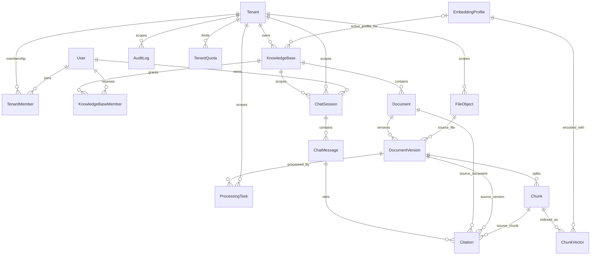

# Agent RAG 系统数据库逻辑模型（评审稿）

状态：**逻辑模型已完成本轮确认；不是最终字段设计或 DDL。** 依据 ADR-001 至 ADR-013 和用户本轮确认结果。六项已确认的逻辑选择见本文件第 1 节；具体字段、唯一约束、索引、外键实现、状态枚举和运维参数仍按文中标注 **PENDING**。数据库暂按 MySQL 思考；MySQL 版本和迁移工具未定。不代表相关实体表已经存在，也不构成数据库实施授权。

## 1. 设计边界与原则

- MySQL 保存关系型业务事实、权限、处理状态、Chunk 完整文本、会话消息、引用、审计和配额。
- Qdrant 保存 embedding vectors 与供检索过滤使用的 Payload；向量本体不进 MySQL。MySQL 中只记录 Profile/Collection/Point 的映射和状态。
- 第一版原始文件位于本地文件系统；MySQL 的 FileObject 逻辑元数据不暴露物理路径给 API。MinIO/S3 是未来适配目标，不是首版运行要求。
- 用户可属于多个租户，通过 TenantMember 取得租户角色；KB 成员权限独立建模。
- tenant_id 必须由服务端认证主体和 TenantMember 授权推导，不能信任前端传入值。
- Document、DocumentVersion、ProcessingTask 各自有不同状态职责；具体状态字段及枚举待确认。
- 同一知识库同一时刻只有一个有效 Embedding Profile。迁移时新旧 Profile 可有并行索引，但旧 Profile 的可查询/回滚阶段和切换协议待确认。
- 文档逻辑删除提交后，检索路径立即排除其 Chunk；异步 Qdrant/文件物理清理不得成为门禁。

### 本轮已确认的逻辑选择

以下为用户明确确认的逻辑模型选择，不改变 ADR-001 至 ADR-013 的状态，也不批准最终字段/DDL：

1. **ChunkVector：** 独立逻辑实体并采用独立数据库表；具体字段、唯一约束和索引留待字段评审。
2. **Profile/Collection：** 一个不可变 EmbeddingProfile 对应一个 Qdrant Collection；模型配置变化创建新的 Profile 和 Collection；不支持同一 Profile 下多个并行 Collection Generation，也不增加该 Generation 实体。
3. **FileObject：** 同一租户内 SHA-256 相同的文件复用同一 FileObject 和物理文件，不跨租户复用；DocumentVersion 引用是文件引用关系基础；`ref_count` 是否物化仍 PENDING。
4. **DocumentVersion 租户字段：** 冗余保存非独立修改的 `tenant_id`，使用组合外键约束租户归属；具体组合键、外键及 ORM 映射留待字段评审。
5. **状态职责：** Document、DocumentVersion、ProcessingTask、ChunkVector、FileObject 分别承担各自状态；ProcessingTask 的 `status` 与 `stage` 分开。Worker lease 过期允许重新领取，并以幂等方式恢复；取消、超时、人工重试和补偿分别设计。具体枚举和执行参数仍 PENDING。
6. **Chat/Citation：** 保留必要历史快照（例如文档标题和必要摘要），但不授予源文件或 Chunk 原文访问权；每次读源文件、Chunk 原文或下载都重新校验当前权限与文档状态。快照字段、脱敏、保留期限和删除策略仍 PENDING。

## 2. 实体数量和 ER 图

本逻辑模型包含 **17 个逻辑实体**。`ChunkVector` 已确认是独立逻辑实体并采用独立表；其字段及约束待字段评审。`FileObject` 已确认在同租户相同 SHA-256 时复用同一逻辑对象和物理文件，引用关系基于 DocumentVersion；引用计数是否物化 PENDING。其余实体字段、类型、约束仍是逻辑设计提案，进入 DDL 前需评审。

ER 图表达逻辑关系，不代表已批准外键实现。KnowledgeBase 的 `active_embedding_profile_id` 表示当前生效配置：多个 KB 可引用同一个 Profile；单个 KB 通过该列至多引用一个当前 Profile。FileObject 复用已确认，因此一个 FileObject 可被同租户多个 DocumentVersion 引用；文件引用事实由这些引用关系构成，计数是否物化 PENDING。ChunkVector 独立实体和独立表已确认，但物理字段/约束未定。

### Profile、Collection 与迁移代际的边界

- **EmbeddingProfile** 是模型/向量空间配置身份（provider、model/revision、维度、距离度量等），不等同于 Qdrant Collection。
- **Collection** 是 Qdrant 中实际存储向量的物理资源。用户已确认一个不可变 Profile 对应一个 Collection；模型配置变化时创建新 Profile 和新 Collection。
- **Generation** 可描述同一 Profile 下的重建代际，但用户已确认不支持同 Profile 多 Collection Generation 并行，也不新增该 Generation 逻辑实体。模型迁移的新旧并存通过不同 Profile/Collection 表达。
- ADR-007 已确定按 KB 整体切换 Profile、验证后切换并保留旧 Collection 支持回滚。迁移增量同步、水位、校验阈值、切换/回滚细节及旧 Collection 保留时长继续 PENDING。

## 3. 数据类型约定

字段类型均为 **MySQL 类型建议**，不是 DDL。示例主键建议 UUID，以 `BINARY(16)` 存储；若选择 `CHAR(36)`、雪花 ID 或其他方式，需统一全库并确认索引/兼容影响。时间建议统一 UTC `DATETIME(3)`，展示层转换时区。金额不在本系统首版范围；配额数量建议整数或 DECIMAL，单位要与资源定义一致。

表格中“默认”写 `无` 表示由业务创建时显式赋值，不主张数据库默认；`NULL` 表示字段可空；约束均为候选逻辑约束。

## 4. 实体字段清单

### 4.1 User

全局身份；角色不放在 User 上。账号可用用户名或邮箱登录，凭证只保存密码哈希，不保存明文密码、JWT 或 refresh token 明文。

| 字段 | 类型建议 | NULL | 默认 | 键/约束建议 | 含义 |
|---|---|---:|---|---|---|
| id | BINARY(16) | 否 | 无 | PK | 全局用户 ID |
| username | VARCHAR(100) | 是 | NULL | UNIQUE（非空时） | 用户名登录名 |
| email | VARCHAR(254) | 是 | NULL | UNIQUE（非空时） | 邮箱登录名 |
| password_hash | VARCHAR(255) | 否 | 无 | — | 密码哈希；哈希算法/参数 PENDING |
| display_name | VARCHAR(150) | 否 | 无 | — | 展示名称 |
| status | VARCHAR(24) | 否 | `ACTIVE`（候选） | CHECK/应用校验候选 | 账户状态；状态集合 PENDING |
| created_at | DATETIME(3) | 否 | 当前时间（候选） | — | 创建时间 |
| updated_at | DATETIME(3) | 否 | 当前时间（候选） | — | 更新时间 |
| deleted_at | DATETIME(3) | 是 | NULL | INDEX 候选 | 逻辑删除时间；账户删除语义待确认 |

至少 username/email 之一非空可作为业务约束，但数据库表达方式/账号规范仍待确认。

### 4.2 Tenant

| 字段 | 类型建议 | NULL | 默认 | 键/约束建议 | 含义 |
|---|---|---:|---|---|---|
| id | BINARY(16) | 否 | 无 | PK | 租户 ID |
| name | VARCHAR(160) | 否 | 无 | 租户内/全局唯一范围 PENDING | 租户名称 |
| status | VARCHAR(24) | 否 | `ACTIVE`（候选） | 状态集合 PENDING | 租户可用状态 |
| created_at | DATETIME(3) | 否 | 当前时间（候选） | — | 创建时间 |
| updated_at | DATETIME(3) | 否 | 当前时间（候选） | — | 更新时间 |
| deleted_at | DATETIME(3) | 是 | NULL | INDEX 候选 | 租户逻辑删除时间 |

### 4.3 TenantMember

用户与租户的多对多关联；role 是成员关系属性。ADR-001 已确定 `user_id + tenant_id` 唯一，ADR-003 已确定租户角色值。

| 字段 | 类型建议 | NULL | 默认 | 键/约束建议 | 含义 |
|---|---|---:|---|---|---|
| id | BINARY(16) | 否 | 无 | PK | 成员关系 ID |
| tenant_id | BINARY(16) | 否 | 无 | FK → Tenant.id；INDEX | 所属租户 |
| user_id | BINARY(16) | 否 | 无 | FK → User.id；INDEX | 用户 |
| role | VARCHAR(16) | 否 | 无 | 候选 CHECK `OWNER/ADMIN/MEMBER` | 租户角色 |
| status | VARCHAR(24) | 否 | 无 | 状态集合 PENDING | 成员状态 |
| joined_at | DATETIME(3) | 是 | NULL | — | 生效/加入时间 |
| created_at | DATETIME(3) | 否 | 当前时间（候选） | — | 创建时间 |
| updated_at | DATETIME(3) | 否 | 当前时间（候选） | — | 更新时间 |

候选 UNIQUE `(tenant_id,user_id)`（与 ADR 描述的 user_id+tenant_id 相同）。成员邀请、禁用后的会话/token 影响 PENDING。

### 4.4 KnowledgeBase

KnowledgeBase 属于一个租户。ADR-007 要按 KB 整体切换 Profile；本逻辑模型以 `active_embedding_profile_id` 解析每 KB 唯一当前 Profile。一个不可变 Profile 对应一个 Collection，多 KB 可以共享该 Profile/Collection。Profile 的目标切换、迁移状态及增量同步细节仍待评审。

| 字段 | 类型建议 | NULL | 默认 | 键/约束建议 | 含义 |
|---|---|---:|---|---|---|
| id | BINARY(16) | 否 | 无 | PK；候选 UNIQUE `(tenant_id,id)` 供组合外键引用 | 知识库 ID |
| tenant_id | BINARY(16) | 否 | 无 | FK → Tenant.id；INDEX `(tenant_id,status)` | 所属租户 |
| name | VARCHAR(160) | 否 | 无 | UNIQUE 候选 `(tenant_id,name)` | 名称 |
| description | VARCHAR(1000) | 是 | NULL | — | 描述 |
| active_embedding_profile_id | BINARY(16) | 是 | NULL | FK 候选 → EmbeddingProfile.id；每 KB 至多一个当前生效值 | 当前生效向量空间 |
| status | VARCHAR(24) | 否 | 无 | 状态集合 PENDING | KB 生命周期/可用状态 |
| created_by | BINARY(16) | 否 | 无 | FK → User.id | 创建者 |
| created_at | DATETIME(3) | 否 | 当前时间（候选） | — | 创建时间 |
| updated_at | DATETIME(3) | 否 | 当前时间（候选） | — | 更新时间 |
| deleted_at | DATETIME(3) | 是 | NULL | — | 逻辑删除时间 |

同一 KB 同时只有一个 active Profile 由单一 `active_embedding_profile_id` 解析；这不限制多个 KB 共享同一个 Profile。FK 只能保证 Profile 存在，不能保证 Profile 与 KB 租户/使用权限匹配，后者需服务层校验。迁移 target Profile、增量同步、切换和回滚细节仍 PENDING；同 Profile 多 Collection generation 已明确不支持。

### 4.5 KnowledgeBaseMember

| 字段 | 类型建议 | NULL | 默认 | 键/约束建议 | 含义 |
|---|---|---:|---|---|---|
| id | BINARY(16) | 否 | 无 | PK | KB 成员关系 ID |
| knowledge_base_id | BINARY(16) | 否 | 无 | FK → KnowledgeBase.id；INDEX | 知识库 |
| user_id | BINARY(16) | 否 | 无 | FK → User.id；INDEX | 被授权用户 |
| role | VARCHAR(32) | 否 | 无 | 角色矩阵 PENDING | KB 内角色 |
| status | VARCHAR(24) | 否 | 无 | 状态集合 PENDING | 授权状态 |
| created_by | BINARY(16) | 否 | 无 | FK → User.id | 授权操作者 |
| created_at | DATETIME(3) | 否 | 当前时间（候选） | — | 授权时间 |
| updated_at | DATETIME(3) | 否 | 当前时间（候选） | — | 更新时间 |

候选 UNIQUE `(knowledge_base_id,user_id)`。KB_ADMIN/EDITOR/VIEWER 权限矩阵 PENDING；Tenant OWNER/ADMIN 管理权限继承 ADR-003，不能因本表覆盖。

### 4.6 FileObject（物理文件逻辑对象）

FileObject 与 Document/DocumentVersion 业务身份分离。FileObject 记录受控存储位置元数据；API 只可经授权业务操作访问，不能返回本地 path。同一租户内 SHA-256 相同的文件复用同一个 FileObject 和物理文件，禁止跨租户复用。DocumentVersion 引用关系是文件引用关系基础；是否物化引用计数、唯一索引对软删除对象的具体实现及并发上传/清理协议留待字段评审。

| 字段 | 类型建议 | NULL | 默认 | 键/约束建议 | 含义 |
|---|---|---:|---|---|---|
| id | BINARY(16) | 否 | 无 | PK；候选 UNIQUE `(tenant_id,id)` 供组合外键引用 | 物理对象逻辑 ID |
| tenant_id | BINARY(16) | 否 | 无 | FK → Tenant.id；INDEX | 去重/权限作用域 |
| storage_key | VARCHAR(512) | 否 | 无 | UNIQUE 候选（仅 key 唯一） | 存储抽象内受控 key，不是公开物理路径 |
| sha256 | BINARY(32) 或 CHAR(64) | 否 | 无 | 逻辑唯一键候选 `(tenant_id,sha256)`；索引实现及软删除行语义待字段评审 | 文件内容摘要 |
| byte_size | BIGINT UNSIGNED | 否 | 无 | CHECK >= 0 候选 | 文件大小 |
| media_type | VARCHAR(127) | 否 | 无 | — | 检测后的 MIME 类型 |
| original_name | VARCHAR(255) | 否 | 无 | — | 原始文件名（展示/审计用途） |
| storage_status | VARCHAR(24) | 否 | 无 | 状态集合 PENDING | 可用/待删除/删除失败等物理状态候选 |
| created_by | BINARY(16) | 否 | 无 | FK → User.id | 上传者 |
| created_at | DATETIME(3) | 否 | 当前时间（候选） | — | 创建时间 |
| delete_requested_at | DATETIME(3) | 是 | NULL | INDEX 候选 | 物理清理请求时间 |
| deleted_at | DATETIME(3) | 是 | NULL | — | 物理删除完成时间 |

同租户 SHA-256 复用语义已确认，但物理唯一约束的实现方式、已删除对象的 hash 再上传行为和 `storage_status` 枚举仍待字段评审。不得使用全局跨租户 hash 去重。当前不预置 `ref_count` 字段；是否物化 PENDING。

### 4.7 Document

Document 是知识库中的业务文档，不是文件字节本身，也不是某次解析版本。逻辑删除在业务事务生效后，检索必须立即屏蔽该文档所有 Chunk。

| 字段 | 类型建议 | NULL | 默认 | 键/约束建议 | 含义 |
|---|---|---:|---|---|---|
| id | BINARY(16) | 否 | 无 | PK；候选 UNIQUE `(tenant_id,id)`、`(knowledge_base_id,id)` | 文档 ID |
| tenant_id | BINARY(16) | 否 | 无 | 通过组合 FK 与 KB 对齐；复合授权索引候选 | 租户作用域快照/检索辅助 |
| knowledge_base_id | BINARY(16) | 否 | 无 | 组合 FK `(tenant_id,knowledge_base_id)` → KnowledgeBase `(tenant_id,id)`；INDEX `(knowledge_base_id,status)` | 所属知识库 |
| display_name | VARCHAR(255) | 否 | 无 | — | 页面展示名 |
| status | VARCHAR(24) | 否 | 无 | 资源状态集合 PENDING | 业务资源是否活动/删除中等；不可复用处理阶段 |
| active_version_id | BINARY(16) | 是 | NULL | 复合 FK 候选 `(id,active_version_id)` → DocumentVersion | 当前可检索版本；需避免循环创建/提交顺序问题 |
| created_by | BINARY(16) | 否 | 无 | FK → User.id | 上传者 |
| created_at | DATETIME(3) | 否 | 当前时间（候选） | — | 创建时间 |
| updated_at | DATETIME(3) | 否 | 当前时间（候选） | — | 更新时间 |
| deleted_at | DATETIME(3) | 是 | NULL | INDEX `(status,deleted_at)` 候选 | 逻辑删除时间/立即屏蔽依据 |

由于 Document 为检索/授权常用租户边界，建议冗余保存 `tenant_id` 并用上述组合 FK 保证与 KB 一致。若目标 MySQL/ORM 不便实现该候选约束，必须在服务层同一事务校验，且不能只对 `tenant_id` 与 `knowledge_base_id` 各建一个独立 FK（两个 ID 各自存在仍可能跨租户错配）。

### 4.8 DocumentVersion

不可变的源文件内容/处理版本；每个版本有自己的任务、Chunks 和来源文件。每版本冗余保存创建时确定的 tenant_id，不能独立修改，并以组合外键校验与 Document/FileObject 的租户归属。只有完整处理并达到验证条件后，才由 Document 切换 active version。

| 字段 | 类型建议 | NULL | 默认 | 键/约束建议 | 含义 |
|---|---|---:|---|---|---|
| id | BINARY(16) | 否 | 无 | PK；候选 UNIQUE `(tenant_id,id)` 供任务作用域组合 FK 引用 | 版本 ID |
| document_id | BINARY(16) | 否 | 无 | FK → Document.id；候选 UNIQUE `(document_id,id)`；INDEX | 所属文档 |
| version_no | INT UNSIGNED | 否 | 无 | UNIQUE `(document_id,version_no)` 候选 | 文档内递增版本号 |
| tenant_id | BINARY(16) | 否 | 无 | 组合 FK 候选 `(tenant_id,document_id)` → Document `(tenant_id,id)`；创建时写入且不可独立修改 | 与文档一致的冗余租户作用域 |
| source_file_id | BINARY(16) | 否 | 无 | 组合 FK 候选 `(tenant_id,source_file_id)` → FileObject `(tenant_id,id)` | 此版本处理的源文件对象；同租户多版本可引用同一 FileObject |
| source_sha256 | BINARY(32) 或 CHAR(64) | 否 | 无 | INDEX 候选 | 版本源内容校验 |
| media_type | VARCHAR(127) | 否 | 无 | — | 实际识别格式 |
| byte_size | BIGINT UNSIGNED | 否 | 无 | — | 文件大小快照 |
| status | VARCHAR(24) | 否 | 无 | 版本/产物状态集合 PENDING | 本版本是否可用/验证/淘汰等 |
| processing_config | JSON | 是 | NULL | — | 解析/切片配置快照；敏感信息不得存入 |
| error_code | VARCHAR(64) | 是 | NULL | — | 最终失败代码 |
| error_message | VARCHAR(1000) | 是 | NULL | — | 可安全展示的错误摘要 |
| created_by | BINARY(16) | 否 | 无 | FK → User.id | 发起者 |
| created_at | DATETIME(3) | 否 | 当前时间（候选） | — | 版本创建时间 |
| activated_at | DATETIME(3) | 是 | NULL | INDEX 候选 | 成为活动版本时间 |
| retired_at | DATETIME(3) | 是 | NULL | — | 退出活动状态时间 |

### 4.9 ProcessingTask

持久化 Worker 的领取/执行事实；租约允许 at-least-once 执行，Qdrant 写入/清理必须幂等。Task 的 status 与 stage 是两个概念：stage 表达当前处理步骤，status 表达本次执行控制状态。Worker 租约过期后允许重新领取并通过幂等机制恢复；取消、超时、人工重试及补偿分别设计，具体状态值/矩阵和参数 PENDING。

| 字段 | 类型建议 | NULL | 默认 | 键/约束建议 | 含义 |
|---|---|---:|---|---|---|
| id | BINARY(16) | 否 | 无 | PK | 任务 ID |
| tenant_id | BINARY(16) | 否 | 无 | FK → Tenant.id；claim/filter index 候选 | 租户调度作用域 |
| document_version_id | BINARY(16) | 是 | NULL | 候选组合 FK `(tenant_id,document_version_id)` → DocumentVersion `(tenant_id,id)`；INDEX | 文档处理任务的版本；清理任务可为空/另建资源关联，待定 |
| task_type | VARCHAR(32) | 否 | 无 | 候选：PROCESS/DELETE/REINDEX；最终值 PENDING | 工作类别 |
| resource_type | VARCHAR(32) | 是 | NULL | 与 resource_id 组合 INDEX 候选；多态关联无数据库 FK | 清理/重建任务的目标类型 |
| resource_id | BINARY(16) | 是 | NULL | 多态业务 ID；需由 task_type/resource_type 校验 | 清理/重建目标资源 ID |
| status | VARCHAR(24) | 否 | 无 | 状态集合 PENDING | 排队/领取/运行/终态控制状态候选 |
| stage | VARCHAR(24) | 是 | NULL | ADR 阶段对应值，最终枚举 PENDING | PARSING/CHUNKING/EMBEDDING/INDEXING 等步骤 |
| idempotency_key | VARCHAR(160) | 否 | 无 | UNIQUE 候选 | 幂等去重键 |
| attempt_count | INT UNSIGNED | 否 | 0 | CHECK >= 0 候选 | 已执行次数 |
| max_attempts | INT UNSIGNED | 是 | NULL | 默认值策略 PENDING | 重试上限 |
| lease_owner | VARCHAR(160) | 是 | NULL | INDEX 与 lease_expires_at 候选 | Worker 实例标识 |
| lease_expires_at | DATETIME(3) | 是 | NULL | INDEX `(status,lease_expires_at)` 候选 | 租约到期时间 |
| heartbeat_at | DATETIME(3) | 是 | NULL | — | 最近心跳 |
| checkpoint | JSON | 是 | NULL | — | 可恢复进度；禁止放凭证/大文本 |
| error_code | VARCHAR(64) | 是 | NULL | — | 最近错误代码 |
| error_message | VARCHAR(1000) | 是 | NULL | — | 脱敏错误摘要 |
| available_at | DATETIME(3) | 否 | 当前时间（候选） | claim index 候选 | 最早可领取/重试时间 |
| started_at | DATETIME(3) | 是 | NULL | — | 首次运行时间 |
| completed_at | DATETIME(3) | 是 | NULL | INDEX 候选 | 终态时间 |
| created_at | DATETIME(3) | 否 | 当前时间（候选） | — | 创建时间 |
| updated_at | DATETIME(3) | 否 | 当前时间（候选） | — | 更新时间 |

ADR 阶段名包含 UPLOADED/QUEUED 等不同语义，需在状态机评审中决定哪些映射到 DocumentVersion.status、Task.status 或 Task.stage。超时、取消、人工重试和补偿机制 PENDING。

### 4.10 EmbeddingProfile

Profile 描述向量空间与 Collection 配置。不同 Profile 不可因维度相同就视为兼容。不能在此保存 API key/secret。

| 字段 | 类型建议 | NULL | 默认 | 键/约束建议 | 含义 |
|---|---|---:|---|---|---|
| id | BINARY(16) | 否 | 无 | PK | Profile ID |
| name | VARCHAR(120) | 否 | 无 | UNIQUE 候选 | 管理名称 |
| provider | VARCHAR(48) | 否 | 无 | — | embedding provider 标识 |
| model_name | VARCHAR(160) | 否 | 无 | INDEX 候选 | 模型名 |
| model_revision | VARCHAR(160) | 是 | NULL | — | 精确模型修订/服务端版本 |
| vector_dimension | INT UNSIGNED | 否 | 无 | CHECK >0 候选 | 向量维数；不是兼容性唯一判据 |
| distance_metric | VARCHAR(24) | 否 | 无 | Profile 固定 | Cosine/Dot/Euclidean 等实际度量 |
| collection_name | VARCHAR(255) | 否 | 无 | 每个不可变 Profile 对应一个 Collection；唯一约束/实现待字段评审 | 此 Profile 对应的 Qdrant Collection 名称/定位 |
| config_fingerprint | BINARY(32) | 否 | 无 | UNIQUE/索引候选 | 不含 secret 的有效配置指纹 |
| status | VARCHAR(24) | 否 | 无 | 状态集合 PENDING | Profile 可用/退役状态 |
| created_at | DATETIME(3) | 否 | 当前时间（候选） | — | 创建时间 |

Embedding/LLM provider 选择 PENDING；模型切换策略按 ADR-007，不在此预设供应商。

### 4.11 Chunk

Chunk 归属一个 DocumentVersion，保存完整文本。`id` 建议 UUID，依据 ADR-006 同 Profile Collection 中 Point ID 等于该 id；多个 Profile 使用不同 Collection。不要把单一 qdrant_point_id/profile_id 当作 Chunk 唯一索引归属。

| 字段 | 类型建议 | NULL | 默认 | 键/约束建议 | 含义 |
|---|---|---:|---|---|---|
| id | BINARY(16) | 否 | 无 | PK；作为同 Profile Collection Point ID | Chunk 稳定 ID |
| document_version_id | BINARY(16) | 否 | 无 | FK → DocumentVersion.id；候选 UNIQUE `(document_version_id,id)`；INDEX | 来源版本 |
| chunk_index | INT UNSIGNED | 否 | 无 | UNIQUE `(document_version_id,chunk_index)` 候选 | 版本内切片序号 |
| content | LONGTEXT | 否 | 无 | — | 完整切片文本 |
| token_count | INT UNSIGNED | 是 | NULL | — | 使用指定 tokenizer 得到的 token 数 |
| char_start | BIGINT UNSIGNED | 是 | NULL | — | 源文本字符起点 |
| char_end | BIGINT UNSIGNED | 是 | NULL | — | 源文本字符终点 |
| content_hash | BINARY(32) 或 CHAR(64) | 否 | 无 | INDEX 候选，非唯一 | 文本内容摘要 |
| created_at | DATETIME(3) | 否 | 当前时间（候选） | — | 创建时间 |

### 4.12 ChunkVector（已确认独立逻辑实体和独立表）

表示一个 Chunk 在一个 Embedding Profile 下的索引实例。ChunkVector 独立逻辑实体和独立数据库表已由用户确认；下列字段、键和索引仍是字段评审候选，不是最终 schema。一个 Profile 对应唯一 Collection，模型变化使用新 Profile/Collection，因此同一 Chunk 可以在新旧 Profile 下各有一条映射，不需要 generation 维度。

| 字段 | 类型建议 | NULL | 默认 | 键/约束建议 | 含义 |
|---|---|---:|---|---|---|
| id | BINARY(16) | 否 | 无 | PK（候选） | 映射记录 ID |
| chunk_id | BINARY(16) | 否 | 无 | FK → Chunk.id；INDEX | 被索引 Chunk |
| embedding_profile_id | BINARY(16) | 否 | 无 | FK → EmbeddingProfile.id；INDEX | 向量空间配置 |
| point_id | BINARY(16) | 否 | 无 | 当前候选为 UNIQUE `(embedding_profile_id,point_id)`；最终唯一约束待字段评审 | Qdrant point ID；ADR-006 约束同 profile 下等于 Chunk UUID |
| index_status | VARCHAR(24) | 否 | 无 | 状态枚举 PENDING | 该 Chunk 在指定 Profile 下的索引状态 |
| indexed_at | DATETIME(3) | 是 | NULL | — | 索引成功时间 |
| last_error_code | VARCHAR(64) | 是 | NULL | — | 最近失败代码 |
| updated_at | DATETIME(3) | 否 | 当前时间（候选） | — | 状态更新时间 |

候选 UNIQUE `(chunk_id,embedding_profile_id)` 表达每个 Chunk/Profile 一条映射；同一 Chunk UUID 可在不同 Profile 对应的 Collection 中复用为 Point ID。用户已确认不支持同 Profile 多 Collection generation 并行，因此本模型不设置 `generation_id`，也不新增 generation 实体。组合唯一键的具体定义、Point ID 字段是否冗余保存（ADR-006 要求逻辑 ID 相同）及索引仍待字段评审。

### 4.13 ChatSession

| 字段 | 类型建议 | NULL | 默认 | 键/约束建议 | 含义 |
|---|---|---:|---|---|---|
| id | BINARY(16) | 否 | 无 | PK | 会话 ID |
| tenant_id | BINARY(16) | 否 | 无 | 组合 FK `(tenant_id,user_id)` → TenantMember；INDEX `(tenant_id,user_id,updated_at)` | 可信租户归属 |
| user_id | BINARY(16) | 否 | 无 | 通过组合 FK 确保用户是租户成员；INDEX | 会话所有者 |
| knowledge_base_id | BINARY(16) | 否 | 无 | 组合 FK `(tenant_id,knowledge_base_id)` → KnowledgeBase `(tenant_id,id)`；INDEX | 会话 KB |
| title | VARCHAR(255) | 是 | NULL | — | 会话标题 |
| status | VARCHAR(24) | 否 | 无 | 删除状态枚举 PENDING | 会话活动/删除状态 |
| created_at | DATETIME(3) | 否 | 当前时间（候选） | — | 创建时间 |
| updated_at | DATETIME(3) | 否 | 当前时间（候选） | — | 最近活动时间 |
| deleted_at | DATETIME(3) | 是 | NULL | INDEX 候选 | 逻辑删除时间 |

候选被引用键：TenantMember UNIQUE `(tenant_id,user_id)`；KnowledgeBase UNIQUE `(tenant_id,id)`。仅有各自独立 FK 到 Tenant、User、KB 不能保证三者归属一致。组合 FK 可保证会话用户确属该租户、KB 属于该租户；成员启用状态及当前 KB 权限仍须服务层在每次访问时检查。若采用 KnowledgeBaseMember 授权，也需服务层判断租户 OWNER/ADMIN 继承规则与成员状态。

### 4.14 ChatMessage

| 字段 | 类型建议 | NULL | 默认 | 键/约束建议 | 含义 |
|---|---|---:|---|---|---|
| id | BINARY(16) | 否 | 无 | PK | 消息 ID |
| session_id | BINARY(16) | 否 | 无 | FK → ChatSession.id；INDEX `(session_id,sequence_no)` | 会话 |
| sequence_no | BIGINT UNSIGNED | 否 | 无 | UNIQUE `(session_id,sequence_no)` 候选 | 会话内顺序 |
| role | VARCHAR(16) | 否 | 无 | 候选 CHECK `USER/ASSISTANT/SYSTEM/TOOL` | 消息角色（ADR-008 Accepted） |
| content | LONGTEXT | 否 | 无 | — | 完整消息正文 |
| status | VARCHAR(24) | 否 | 无 | 状态集合 PENDING | 生成/完成/失败/取消等；枚举待定 |
| error_code | VARCHAR(64) | 是 | NULL | — | 生成失败代码 |
| started_at | DATETIME(3) | 是 | NULL | — | 生成开始时间 |
| completed_at | DATETIME(3) | 是 | NULL | INDEX 候选 | 生成完成时间 |
| created_at | DATETIME(3) | 否 | 当前时间（候选） | — | 创建时间 |
| deleted_at | DATETIME(3) | 是 | NULL | — | 删除时间；消息/引用保留策略 PENDING |

### 4.15 Citation

Citation 指向产生回答时的特定 DocumentVersion/Chunk，并保留必要历史快照，例如文档标题和必要摘要。具体快照字段、内容范围、脱敏和保留/删除策略 PENDING。快照不能恢复已删除文档的检索或原件访问权限；读取源文件或 Chunk 原文时必须重新验证当前权限和文档状态。

| 字段 | 类型建议 | NULL | 默认 | 键/约束建议 | 含义 |
|---|---|---:|---|---|---|
| id | BINARY(16) | 否 | 无 | PK | 引用 ID |
| message_id | BINARY(16) | 否 | 无 | FK → ChatMessage.id；INDEX | 产生引用的 AI 消息 |
| document_id | BINARY(16) | 否 | 无 | 与版本组合 FK `(document_id,document_version_id)` → DocumentVersion `(document_id,id)`；INDEX | 来源文档 |
| document_version_id | BINARY(16) | 否 | 无 | 与文档及 Chunk 组合 FK 校验；INDEX | 检索时来源版本 |
| chunk_id | BINARY(16) | 否 | 无 | 组合 FK `(document_version_id,chunk_id)` → Chunk `(document_version_id,id)`；INDEX | 来源切片 |
| score | DOUBLE | 否 | 无 | — | 检索相似度分数 |
| rank | INT UNSIGNED | 否 | 无 | — | 返回排序名次，从 1 起候选 |
| title_snapshot | VARCHAR(255) | 是 | NULL | 快照具体字段与长度待字段评审 | 历史展示文档标题候选 |
| snippet_snapshot | TEXT | 是 | NULL | 快照内容范围、脱敏和保留策略 PENDING | 必要历史摘要候选；不得用于绕过授权读取源 Chunk |
| created_at | DATETIME(3) | 否 | 当前时间（候选） | — | 引用创建时间 |

### 4.16 AuditLog

重要业务/管理操作需审计且独立保留。避免记录密码、JWT、API Key、完整上传文件或不必要的消息正文。

| 字段 | 类型建议 | NULL | 默认 | 键/约束建议 | 含义 |
|---|---|---:|---|---|---|
| id | BINARY(16) | 否 | 无 | PK | 审计记录 ID |
| tenant_id | BINARY(16) | 是 | NULL | FK → Tenant.id；INDEX `(tenant_id,created_at)` | 租户范围；系统级行为可为空 |
| actor_user_id | BINARY(16) | 是 | NULL | FK → User.id；INDEX | 操作者，系统任务可为空 |
| trace_id | VARCHAR(64) | 是 | NULL | INDEX 候选 | 请求/任务追踪标识 |
| action | VARCHAR(100) | 否 | 无 | INDEX `(action,created_at)` 候选 | 动作名称 |
| resource_type | VARCHAR(64) | 否 | 无 | INDEX `(resource_type,resource_id)` 候选 | 资源类型 |
| resource_id | BINARY(16) | 是 | NULL | — | 资源 ID |
| outcome | VARCHAR(24) | 否 | 无 | 成功/拒绝/失败状态，枚举待定 | 操作结果 |
| detail | JSON | 是 | NULL | — | 脱敏最小必要事件信息 |
| created_at | DATETIME(3) | 否 | 当前时间（候选） | INDEX | 发生时间 |

审计保留期限/分区归档策略 PENDING。

### 4.17 TenantQuota

ADR-012 要求首版支持配置化租户配额，但配额项、默认值和超限行为均 PENDING。建议一行表达一个租户的一类额度；不能把候选字段理解为已确认的配额项目。

| 字段 | 类型建议 | NULL | 默认 | 键/约束建议 | 含义 |
|---|---|---:|---|---|---|
| id | BINARY(16) | 否 | 无 | PK | 配额记录 ID |
| tenant_id | BINARY(16) | 否 | 无 | FK → Tenant.id；UNIQUE 候选 `(tenant_id,quota_key)` | 租户 |
| quota_key | VARCHAR(64) | 否 | 无 | 同租户唯一 | 配额种类（如存储/文档数候选） |
| limit_value | DECIMAL(20,4) | 否 | 无 | CHECK >=0 候选 | 限额数值 |
| unit | VARCHAR(24) | 否 | 无 | 配额定义 PENDING | 字节/个数/并发等单位 |
| period | VARCHAR(24) | 是 | NULL | 适用配额项才设 | 时间窗口；是否需要待定 |
| enabled | BOOLEAN | 否 | TRUE（候选） | — | 是否启用该限制 |
| updated_by | BINARY(16) | 是 | NULL | FK → User.id | 最近修改人 |
| updated_at | DATETIME(3) | 否 | 当前时间（候选） | — | 修改时间 |

## 5. 主键、外键、唯一和索引总建议

### 多租户与跨实体完整性约束建议

以下是逻辑约束建议，仍需结合 MySQL 版本、ORM 和建表评审验证；不能将独立有效的外键误认为组合业务关系已成立。

| 关系 | 涉及字段/约束建议 | 组合外键或服务层边界 |
|---|---|---|
| KnowledgeBase → Tenant | `KnowledgeBase(tenant_id)` FK → `Tenant(id)`；另设 UNIQUE `(tenant_id,id)` 供下游引用 | 单一 FK 已能确保 KB 的租户存在。 |
| KnowledgeBase → active EmbeddingProfile | `KnowledgeBase.active_embedding_profile_id` FK → `EmbeddingProfile(id)`；一个不可变 Profile 对应一个 Collection | 多个 KB 可引用同一 Profile；单列至多表达一个 active Profile。模型变化创建新 Profile/Collection；同 Profile 多 Collection generation 不支持。Profile 配置访问边界由服务层管理。 |
| Document → Tenant/KnowledgeBase | `Document(tenant_id,knowledge_base_id)` FK → `KnowledgeBase(tenant_id,id)`；KB 候选 UNIQUE `(tenant_id,id)` | 防止 tenant A 的 Document 指向 tenant B 的 KB。Document `tenant_id` 单独 FK + `knowledge_base_id` 单独 FK 不足以保证归属一致。 |
| FileObject → Tenant | `FileObject.tenant_id` FK → `Tenant.id`；候选 UNIQUE `(tenant_id,id)`；SHA-256 同租户复用逻辑已确认 | DocumentVersion 引用形成对象引用关系。`(tenant_id,sha256)` 物理唯一索引细节、`created_by` 是否必须是租户成员需字段/服务层评审；跨租户 hash 复用禁止。 |
| DocumentVersion → Document/FileObject | Version 保存不可独立修改的 `tenant_id`；组合 FK 候选 `(tenant_id,document_id)` → Document `(tenant_id,id)`，以及 `(tenant_id,source_file_id)` → FileObject `(tenant_id,id)`；候选 UNIQUE `(document_id,id)` 和 `(tenant_id,id)` | 冗余 tenant_id 已确认；具体组合键、外键和 ORM 映射待字段评审。两条组合关系防止版本与文档/文件的租户归属不一致。 |
| Document.active_version → DocumentVersion | Document `(id,active_version_id)` → DocumentVersion `(document_id,id)`；后者 UNIQUE `(document_id,id)` | 限制 active version 属于本 Document。与 Version.document_id 构成循环关系，需评估延迟约束或由事务服务保证，DDL 实现 PENDING。 |
| Chunk → DocumentVersion | `Chunk.document_version_id` FK → Version；候选 UNIQUE `(document_version_id,id)` | 不在 Chunk 重复存 Document/Tenant/KB 时，版本 FK 已可追溯归属。若未来冗余作用域字段，则必须同步组合约束。 |
| ChatSession → Tenant/User/KnowledgeBase | 候选 FK `(tenant_id,user_id)` → TenantMember `(tenant_id,user_id)`；FK `(tenant_id,knowledge_base_id)` → KnowledgeBase `(tenant_id,id)` | 防止会话用户不是该租户成员、或 KB 属于另一个租户。成员 ACTIVE、用户状态和 KB 权限必须服务层检查；FK 不支持状态谓词。 |
| Citation → ChatMessage/DocumentVersion/Chunk | `document_version_id`+`document_id` FK → Version `(document_id,id)`；`document_version_id`+`chunk_id` FK → Chunk `(document_version_id,id)`；`message_id` FK → ChatMessage | 两条组合 FK 可证明 Citation 的 Version 与 Chunk 是同源，并将版本绑定到指定 Document。独立四条 FK 仅能证明实体各自存在，不能防止混搭。Citation 来源与 ChatSession 的 tenant/KB 是否一致仍由问答服务在写入时授权校验；若要求数据库也强制，需在 Citation 冗余 session/tenant/KB scope 并建立更宽组合键，代价较大，本稿不建议未经确认引入。 |

`TenantMember(tenant_id,user_id)`、`KnowledgeBase(tenant_id,id)`、`Document(tenant_id,id)`、`DocumentVersion(document_id,id)`、`DocumentVersion(tenant_id,id)`、`FileObject(tenant_id,id)`、`Chunk(document_version_id,id)` 等候选被引用组合键需要在字段评审确认是否建 UNIQUE 索引。服务层校验适用于动态授权、状态/软删除、成员角色等谓词；静态归属一致性优先用组合外键，避免竞态和脏关联。

### 主键

业务实体使用统一 UUID；Chunk UUID 同时作为其在每个 Profile 对应 Collection 中的 Qdrant point ID（ADR-006 Accepted）。ChunkVector 已确认独立实体/表；字段及键约束 PENDING。所有 API 需避免把可枚举顺序 ID 暴露为权限凭据。

### UUID 编码约定建议（实现前需统一）

- 统一采用 RFC 4122/9562 UUID 的 128-bit 值。MySQL `BINARY(16)` 按 UUID 的 16 个网络序字节存储：先写 UUID most-significant 64 bits，再写 least-significant 64 bits；每个 64-bit 部分均按大端序。
- Java `UUID` 的两个 long 字段按 `getMostSignificantBits()`、`getLeastSignificantBits()` 顺序分别以大端序编码，合并成 16 字节；读取时按相同顺序解码。文本使用标准 `xxxxxxxx-xxxx-xxxx-xxxx-xxxxxxxxxxxx` 格式解析/格式化。
- Qdrant UUID Point ID 使用相同 UUID 值的标准文本表示。Chunk 的 MySQL 主键、Java UUID 和 Qdrant Point ID 必须代表完全相同的 128 bits；不得因 Base64、大小端翻转或截断产生另一 ID。
- 不使用 MySQL `UUID_TO_BIN(uuid, 1)` 的时间字段重排形式，除非全栈明确统一使用并实现对应逆变换；本建议是无重排字节序。Java `ByteBuffer` 的默认大端序可作为实现习惯，但应显式设定以免依赖隐式默认。
- 实施时应为全零、分段递增及随机 UUID 建立 round-trip 校验样例：文本 → Java UUID → BINARY(16) → UUID → Qdrant 文本往返一致。此处是规范建议，不修改本轮代码，也不表示已完成实现。

### 外键

逻辑候选：TenantMember→Tenant/User；KnowledgeBase→Tenant/active Profile；KBMember→KB/User；Document→Tenant/KB；DocumentVersion(含不可变 tenant_id)→Document/FileObject；Task→Tenant/DocumentVersion（清理类 task 关联可空/替代引用待定）；Chunk→DocumentVersion；独立 ChunkVector→Chunk/Profile；Session→TenantMember/KB；Message→Session；Citation→Message/Document/Version/Chunk；AuditLog/Quota→Tenant。可静态表达的归属一致性优先用组合外键，动态授权、状态和删除门禁用服务层检查；不得仅依赖前端参数。

### 唯一约束候选

- TenantMember `(tenant_id,user_id)`：ADR-001 已明确唯一。
- KnowledgeBase `(tenant_id,id)`、FileObject `(tenant_id,id)`、Document `(tenant_id,id)`、DocumentVersion `(document_id,id)` 与 `(tenant_id,id)`、Chunk `(document_version_id,id)`：组合外键的候选被引用键。
- KnowledgeBaseMember `(knowledge_base_id,user_id)`：候选，是否允许多角色/历史授权待定。
- DocumentVersion `(document_id,version_no)`。
- Chunk `(document_version_id,chunk_index)`。
- ChunkVector `(chunk_id,embedding_profile_id)`：候选 UNIQUE。每 Profile 一个 Collection 且不设同 Profile Generation 已确认；该唯一约束是否物理建立、point_id 是否作为冗余列仍待字段评审。
- ChatMessage `(session_id,sequence_no)`。
- TenantQuota `(tenant_id,quota_key)`：仅在“一租户一配额项”模型确认后采用。
- FileObject `(tenant_id,sha256)`：同租户复用已确认；唯一索引如何兼容保留的已删除元数据仍待字段评审。

### 查询索引候选

- TenantMember `(user_id,status)`、`(tenant_id,status,role)`。
- KnowledgeBase `(tenant_id,status,updated_at)`；KBMember `(user_id,status,knowledge_base_id)`。
- Document `(knowledge_base_id,status,created_at)`、`(tenant_id,status,deleted_at)`。
- DocumentVersion `(document_id,version_no)` 和活动/状态查询索引。
- ProcessingTask 领取扫描 `(status,available_at,lease_expires_at)`，以及 `(tenant_id,status,created_at)`；具体抢占锁语义和 MySQL 版本支持待定。
- Chunk `(document_version_id,chunk_index)`；长文本不做常规全文索引，是否需要全文搜索另行评审。
- ChunkVector `(embedding_profile_id,index_status)`（独立表已确认，具体索引候选）。
- ChatSession `(tenant_id,user_id,updated_at)`；ChatMessage `(session_id,sequence_no)`。
- Citation `(message_id,rank)`、`(document_id,document_version_id)`。
- AuditLog `(tenant_id,created_at)`、`(action,created_at)`。
- TenantQuota `(tenant_id,quota_key)`。

具体索引应由真实查询、租户基数、数据量与 MySQL 版本校验，不能仅因字段出现在逻辑草案就全部建索引。

## 6. ChunkVector 方案确认记录与字段影响

### 方案 A：独立 ChunkVector 表/实体

每个 `(chunk_id, embedding_profile_id)` 有独立索引记录，保存 point_id、状态、成功时间和错误摘要。

**优点：** 能同时表达多个 Profile 的索引、迁移部分失败、重试、旧向量清理和每 KB 切换；每个映射行独立更新状态，支持失败重试及 Qdrant 删除确认；不会覆盖稳定 Chunk 内容。文档重处理形成新 DocumentVersion/Chunk，旧 Chunk 的向量映射可独立退役，不会覆盖当前版本索引记录。

**缺点：** 增加关系和写事务；迁移任务/清理任务关联仍需设计；高向量量级下索引表可能很大。每个 Profile 只有一个 Collection 已确认，同 Profile 多 Collection 并行不属于本模型能力。

### 方案 B：索引状态嵌入 Chunk

Chunk 上放单一 `embedding_profile_id/qdrant_point_id/index_status`，或用 JSON/多列集合放 Profile 状态。

**优点：** 只有一个 Profile 且永不并行迁移时模型简单，join 少。

**缺点：** ADR-007 需要新旧 Collection 并存；单列只能表示一个索引。JSON/重复列难以唯一约束、并发更新、按 Profile/代际查询、重试和清理，且容易丢失旧索引状态。文档重处理还会混淆稳定 Chunk 内容身份与不同版本各自的索引状态。

### 用户确认结果与字段边界

ChunkVector 独立逻辑实体和独立数据库表已经确认，不再作为本模型 PENDING。具体字段、唯一约束、索引、是否冗余保存与 Chunk 相同的 `point_id` 仍待字段评审。一个 Profile 对应一个 Collection；不同模型通过不同 Profile 表达，不设 generation 维度。MySQL 与 Qdrant 无共同事务，索引映射需通过幂等 upsert/delete、状态推进、可重试任务和周期对账实现最终一致；迁移增量同步、水位、校验、切换和保留细节仍 PENDING。

## 7. 状态与流程关系

| 逻辑对象 | 状态职责 | 状态候选/注意事项 |
|---|---|---|
| Document | 用户可见业务资源生命周期 | 具体枚举 PENDING；不能放 PARSING/EMBEDDING 等处理阶段 |
| DocumentVersion | 版本产物处理结果与可用性 | 新版未完成时旧 active version 继续可检索；具体枚举 PENDING |
| ProcessingTask | 任务执行状态与单独的处理 stage | lease 过期可重新领取并以幂等方式恢复已确认；状态枚举和取消/超时/人工重试/补偿细节 PENDING |
| ChunkVector | 指定 Chunk 在指定 Profile 下的索引状态，独立表已确认 | 状态枚举与重试/删除细节 PENDING；Qdrant point 清理失败不能直接将 Document 恢复可用 |
| FileObject | 物理文件状态和清理生命周期 | 状态枚举、并发协议和 `ref_count` 物化与否 PENDING；与 Document 逻辑删除分离 |

ADR-009 阶段 `UPLOADED/QUEUED/PARSING/CHUNKING/EMBEDDING/INDEXING/COMPLETED/FAILED/CANCELLED` 不可全部复用为 Document 状态。至少需区分：UPLOADED 更接近资源/版本接收，处理阶段归 Task stage，执行结果归 Task.status，版本检索可用性归 DocumentVersion。最终映射由状态机评审决定。

## 8. 数据删除与保留策略

1. **文档逻辑删除事务：** Document 状态改为禁止新检索并记录删除请求；从此刻起检索结果必须做 MySQL 权威状态门禁，不能等 Qdrant 清理。
2. **异步清理任务：** 创建可重试/幂等的清理工作，删除该 Document 所有版本/Profile 的 Qdrant points；清理 FileObject 时必须先判断该物理对象是否仍被其他 DocumentVersion 引用。同租户文件复用已确认，引用计数是否物化及删除/上传并发协议 PENDING。
3. **失败处理：** Qdrant/文件清理失败记录状态、attempt/错误并重试；周期对账发现孤儿 point、缺失 point 或孤儿文件。可用任务表承载，但清理 job 与文档处理 task 是否同表待设计。
4. **完成态：** 物理清理成功后记录完成时间；是否硬删除业务元数据或保留 tombstone 由不同数据类型的保留策略控制，期限 PENDING。
5. **Chat Citation：** Citation 指向 document/version/chunk 并保留必要历史快照；源文档删除后不得重新检索或访问原件/Chunk 原文。快照字段、内容范围、脱敏、保留期限和用户删除会话时如何清理仍 PENDING。
6. **审计：** AuditLog 独立保留策略，不因业务对象删除同步清掉；保留期限、归档和脱敏规则 PENDING。
7. **租户删除：** 需要编排 KB、文档、Qdrant、文件、会话、引用、配额和审计生命周期；执行顺序及保留法律/产品要求未确认，当前不定义级联物理删除。

## 9. PENDING 决策及其结构影响

### 17 个逻辑实体的完整性复核

当前 17 个逻辑实体没有发现必须立即新增的通用业务表，但有三类关系/职责边界需要在后续评审中明确：

1. `EmbeddingProfile` 与 `KnowledgeBase.active_embedding_profile_id` 的关系已在 ER 图表达。一个不可变 Profile 对应一个 Collection，模型变化采用新 Profile/Collection；同 Profile 多 Generation 不支持，因此不增加对应实体。
2. `ChunkVector` 已确认是独立逻辑实体并采用独立表，职责为保存 Chunk/Profile 索引映射和状态；字段、键、索引仍待字段评审。
3. `ProcessingTask.resource_type/resource_id` 是多态目标，数据库不能用普通 FK 校验指向 Document、Profile 或集合清理目标。可选做法是将各任务类型引用拆成强类型 nullable FK、增加资源任务关联表，或保留多态字段并服务层校验；具体取舍与清理任务设计 PENDING。当前不直接扩充实体。

职责复核：FileObject 与 Document/DocumentVersion 分离并非重复，分别表达字节对象和业务文档版本；Document 与 DocumentVersion 分离支持不可变重处理；Chunk 与 ChunkVector 分离代表文本与索引状态；Citation 与 ChatMessage 分离支持结构化来源。`TenantQuota` 仅保存额度定义，不等于已决定的用量计数存储；用量表/缓存未有足够业务依据，不添加。当前业务所需的身份、租户、知识库、文件/文档、任务/索引、对话/引用、审计/配额领域均有代表实体。

### Citation 可追溯性及删除后的访问边界

Citation 的 `message_id` 精确定位产生引用的消息；`document_id + document_version_id` 绑定文档和版本；`document_version_id + chunk_id` 约束引用切片确属该版本。因此不会出现各 ID 独立存在但拼接到不同文档/版本/Chunk 的引用。引用对应消息是否为 ASSISTANT 角色需写入服务校验（或通过受控生成流程保证），普通 FK 不能约束跨表 role 条件。

文档删除后，历史引用可作为历史关系保留并含必要快照，但不得通过 Citation 回到 Qdrant 检索或绕过当前 Document 状态、租户/KB 权限去读取原文件或 Chunk 原文。快照字段、内容范围、何时清除仍 PENDING。对已删除文档的授权访问和内容保留期限也 PENDING。避免对 Citation 配置无条件级联硬删除，具体物理保留/级联策略待 Chat 保留决策确认。

| PENDING | 影响的逻辑设计 |
|---|---|
| Access/Refresh token 生命周期、刷新、撤销 | User 凭证/撤销版本或 Token 表是否需要；本模型不强加 RefreshToken 表。 |
| KB_ADMIN/EDITOR/VIEWER 权限矩阵 | KnowledgeBaseMember.role 枚举、权限查询和索引。 |
| 系统级管理员边界 | 是否需要全局角色/系统管理员关联；当前不在 User.role 上预定字段。 |
| FileObject 引用计数与并发协议 | `ref_count` 是否物化、同 hash 对象处于删除流程时上传如何协调、物理唯一索引怎样处理软删除行。 |
| 任务超时、取消、人工重试、补偿 | ProcessingTask 状态、deadline、attempt、父子任务/补偿关联字段。 |
| SSE 续传/重复事件 | ChatMessage event sequence/cursor 或独立 ChatEvent 表；当前没有强加事件表。 |
| Chat/引用删除及保留 | `deleted_at`/purge timestamps、已确认的必要 Citation 快照具体字段/脱敏/期限和级联行为。 |
| 配额默认值和超限处理 | TenantQuota 项目、类型/单位/周期、是否需要 usage counter 表。 |
| Embedding/LLM provider 选择 | EmbeddingProfile provider/model 字段具体性；LLM profile 是否入库及独立实体。 |
| Embedding 迁移增量同步和原子切换 | 迁移任务/水位/变更日志/双写表；旧 Collection 保留时长、验证阈值及失败回滚细节。 |
| Document/Version/Task/ChunkVector/FileObject 状态机 | 具体 enum 值、默认值、终态/转移校验；超时、取消、人工重试、退避、lease 时限和补偿模型。 |
| MySQL 版本与迁移工具 | UUID/JSON/索引/锁领取方案和 DDL 语法。 |

## 10. 设计风险

- MySQL 与 Qdrant/文件系统无共同事务，必须设计幂等操作与对账；逻辑删除即时屏蔽不能寄希望于物理清理成功。
- 文件复用关系已确认；按 `(tenant_id,sha256)` 建物理唯一索引仍需明确软删除对象的唯一语义和并发协调，`ref_count` 是否物化未定。
- ChunkVector 独立表已确认；需在字段评审确定其字段/唯一约束，并确保任务重试和清理能对账。不得恢复 Chunk 单一 point/profile 字段设计。
- 一个 Profile 对应一个 Collection、同 Profile 多 generation 不支持已确认；但迁移期间不同 Profile 的增量同步/水位/切换和旧集合保留时长仍未定。
- KnowledgeBase 的 active Profile 是 ADR-007 的逻辑要求；若没有唯一可解析指针，检索可能混读新旧向量空间。
- Document.active_version_id 与 DocumentVersion.document_id 形成引用环；最终 DDL 可用延后校验/事务顺序/应用不变量处理，现阶段不确定外键执行方案。
- DocumentVersion 冗余 tenant_id 已确认，必须不可独立修改，并在字段评审落实与 Document/FileObject 的组合约束；仅分别验证 ID 存在不足以保证归属一致。
- 长文本、JSON、索引长度、CHECK 支持及 Worker claim 锁语义依赖 MySQL 版本，当前版本 PENDING。
- 17 个逻辑实体不等于最终需要 17 张物理表；如合并/拆分实体需保持 ADR 语义。

## 11. 评审清单

进入下一步最终字段定稿/DDL 前请评审：

1. 17 个逻辑实体划分保持不变；字段、类型、组合唯一键/外键与索引进入逐项字段评审。
2. ChunkVector 独立实体和独立表、每 Profile 一 Collection、禁止同 Profile 多 generation 已确认；Point ID 的物理冗余存储与键索引仍待评审。
3. FileObject 同租户 hash 复用已确认；ref_count、hash 唯一索引对软删除行的语义、并发上传/清理协议 PENDING。
4. DocumentVersion.tenant_id 冗余且创建时固定已确认；组合 FK/唯一键与 ORM 映射 PENDING。
5. 五类对象状态职责、lease 过期重领和幂等恢复已确认；具体状态机与重试/补偿参数 PENDING。
6. 必要 Citation 快照及每次访问源内容重新鉴权已确认；字段、脱敏、保留期限和删除策略 PENDING。
7. Access/Refresh Token、KB role matrix、系统管理员权限、模型供应商仍 PENDING。
8. Profile 迁移增量同步、水位、校验阈值、旧 Collection 保留时长、MySQL 版本和迁移工具仍 PENDING。

六项逻辑选择已归档，可进入下一轮逐项字段级评审。其他 PENDING 未收敛前不建议进入最终 DDL/迁移阶段。本轮未生成 DDL。
