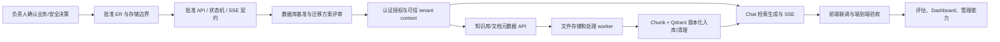

# 开发阶段与优先级任务

这是按当前代码缺口整理的建议计划，不是已批准路线图。优先级和验收标准待项目负责人确认；实现前先确认需求、API 契约与数据模型。

## 阶段 0：基线梳理（本轮文档整理已完成）

- 记录前后端技术栈、模块和接口边界。
- 记录 RAG 流程实现状态、安全风险与业务关系草案。
- 本轮为源码/config 静态核对，未运行集成验证。

## P0：安全与基础架构决策

1. 确认认证授权方案、角色模型和匿名接口范围；当前没有登录/JWT/Spring Security，不预设具体技术方案。
2. 定义可信租户上下文；服务端应将认证主体与检索、写入的租户权限绑定。当前只按客户端 tenantId 过滤，不能作为授权边界。
3. 确认 User/Tenant/KnowledgeBase/Member/Document/Chunk/Chat 数据模型，以及 MySQL 与 Qdrant 的职责、迁移策略；确认前不建表。
4. 核定生产 Actuator 策略：当前 `health.show-details: always`，确认匿名是否可见组件详情及未部署 MySQL 时健康状态预期。
5. 确定统一 API 成功/错误结构、生产代理/同域部署与 CORS 策略。

## P1：核心业务闭环

1. 文档上传、原件存储和文件校验。
2. 文档解析、切片、异步状态、失败重试与可观测性。
3. Chunk/Qdrant Point 映射与 tenant/knowledgeBase/document metadata filter，及删除一致性策略。
4. 知识库、文档和切片 API 与业务元数据持久化。
5. Chat 后端：Query embedding、检索、Prompt 组装、ChatModel 生成、引用来源与 POST SSE；先确认事件协议、错误和断开取消行为。
6. ChatSession/ChatMessage 持久化和租户授权。
7. 前端 pending 接口按已确认契约逐项联调，并同步更新 API registry 与 Workspace 文档。

## P2：管理、质量与扩展

1. 租户/用户管理 API 与界面（依赖认证和数据模型决策）。
2. Dashboard 聚合指标及统计口径。
3. 评估数据集、检索指标、可选 LLM 评价和历史记录。
4. 分页排序、审计、体验和性能优化。
5. 自动化单元/集成测试、Qdrant/MySQL 环境验证、部署与备份演练。

## 依赖与验收原则

- P0 的安全和模型决策是 P1 持久化/API 实现的前置条件。
- 页面可打开不算端到端完成；需要验证真实后端接口和持久化。
- 多租户验收需验证越权读写，并基于可信身份上下文，而非只变更请求 tenantId。
- 数据库变更同步基准结构和迁移文档；API/流程变化同步 architecture、requirements 与开发契约。
- 具体迭代范围与验收标准待确认。

## 架构决策确认清单（进入数据库设计前）

1. 用户是否允许加入多个租户；活动租户选择规则；TenantMembership 及租户内角色。
2. 认证方式与身份提供方；系统管理员、租户管理员、普通成员权限；匿名注册/邀请流程。
3. tenantId 如何绑定已认证主体；所有 tenant-scoped API 的强制授权策略及 Actuator 公开范围。
4. KnowledgeBase 是否严格归属单一租户；成员权限角色与共享/跨租户知识库是否允许。
5. Qdrant Collection 选型：按租户、按知识库或共享 Collection + Payload filter；embedding profile 是否决定 Collection 边界。
6. 文件存储位置、支持格式/限制、文档状态机、同步/异步处理、重试和原件保留周期。
7. Chunk 全文是否保存在 MySQL；Point ID 与业务 ID 映射；向量 payload 字段及文档重处理/删除补偿语义。
8. embedding profile 需记录哪些 provider/model/revision/dimension 信息，以及模型升级时是否允许双 Collection 灰度。
9. 会话/消息持久化范围、Chat 历史上下文策略、检索引用保存快照与隐私保留期限。
10. POST SSE 事件协议（token、citation、done、error）、断连时生成是否取消、assistant 消息如何标记部分输出。
11. MySQL 目标版本、迁移工具、备份恢复与一致性任务的运行方式。

未得到确认前，database 文档中的实体字段和关系均保持建议草案；不得落成 DDL 或应用实体。

## 后续任务依赖图

其中数据库 DDL/迁移仅在模型批准且获得实施任务后开展；本次只完成设计文档，不表示任何阶段已进入编码。
